# X6100 custom firmware: manual

How to use every part of the firmware, and the reference tables. The short
overview is the [README](../README.md).

Each option has a "Where:" line with its place on the radio, for example
"Where: Settings > Display > MAIN SCREEN". Settings opens from APP (page 2) >
Settings. Button and option names are written as the radio shows them.

## Contents

- [Getting started](#getting-started): [first steps](#first-steps), [buttons and knobs](#buttons-and-knobs)
- [Updating the firmware](#updating-the-firmware)
- [Main screen](#main-screen): [low battery](#low-battery), [battery time](#battery-time), [status bar](#status-bar), [S-meter](#s-meter), [waterfall](#waterfall), [screen recording](#screen-recording), [Walkie Talkie](#walkie-talkie-mode)
- [Settings](#settings): [General](#general-tab), [Display](#display-tab), [Audio](#audio-tab), [Wireless](#wireless-tab), [Bluetooth](#bluetooth-tab), [Keys](#keys-tab), [Cluster](#cluster-tab), [TX Cal](#tx-cal-tab), [Info](#info-tab), [Update](#update-tab), [Walkie](#walkie-tab)
- [Transmitting](#transmitting): [digital-mode TX level](#digital-mode-tx-level), [recording voice messages](#recording-voice-messages), [ALC in CW](#alc-in-cw)
- [Digital modes](#digital-modes): [opening a mode](#opening-a-mode), [FT8 and FT4](#ft8-and-ft4), [JS8](#js8), [WSPR](#wspr), [SSTV, WeFax and NavTex](#sstv-wefax-and-navtex), [PSK31, PSK63 and Olivia](#psk31-psk63-and-olivia), [JTTY](#jtty), [RTTY and WeFax TX](#rtty-and-wefax-tx)
- [CW](#cw): [CW decoder](#cw-decoder), [CW from the keyboard](#cw-from-the-keyboard), [USB paddle](#usb-paddle), [CW messages](#cw-messages), [CW Trainer](#cw-trainer)
- [Apps](#apps): [DX Cluster](#dx-cluster), [Field Ops (SOTA / POTA)](#field-ops-sota--pota), [Bands](#bands), [Channels](#channels)
- [Bluetooth](#bluetooth): [headphones](#bluetooth-headphones), [CAT](#bluetooth-cat)
- [Themes](#themes)
- [Web configurator](#web-configurator)
- [X6100 Link app](#x6100-link-app)
- [wfview server](#wfview-server)
- [Ethernet](#ethernet): [USB tethering](#usb-tethering)
- [Troubleshooting and FAQ](#troubleshooting-and-faq)
- [Reference](#reference): [Bluetooth CAT connection](#bluetooth-cat-connection), [CI-V commands](#supported-ci-v-commands), [btcat-ctl](#btcat-ctl), [btaudio-ctl](#btaudio-ctl), [files on /mnt](#files-on-mnt)
- [Build](#build)

## Getting started

### First steps

1. Set your callsign and QTH locator.
   Where: Settings > General > STATION.
   JS8, FT8, WSPR (TX and upload) and the DX Cluster need the callsign.
2. Connect to a WiFi network, for example your phone's hotspot.
   Where: Settings > Wireless > WIFI.
   WiFi sets the clock, and the DX Cluster, uploads and the X6100 Link app
   need it.
3. Check the clock. FT8, JS8 and WSPR need it right to a second or two.
   Where: Settings > General > DATE / TIME.
4. Open the web configurator from a browser on the same network:
   `http://<radio IP>/` (see [Web configurator](#web-configurator)).

### Buttons and knobs

The APP button opens three pages of apps and tools:

| Page | Buttons |
|---|---|
| APP 1:3 | Modes, Cluster, SWR Scan, RX Recorder |
| APP 2:3 | Settings, CW Trainer, Field Ops, Channels |
| APP 3:3 | Bands, GPS, Screen rec |

- Each app has its own button pages, named like `(JS8 1:7)`. The first
  button goes to the next page.
- The MFK walks the items of an app or a list; a press chooses.
- ESC closes popups and apps.
- A press of VOL does not close menus or apps, and in a text field it types
  nothing; on the main screen it still works as ESC.

Long press. Each button group (GEN, APP, KEY, MSG, DFN, DFL) has a
long-press action.
Where: Settings > Keys > FRONT KEYS, LONG PRESS.

| Kind | Actions |
|---|---|
| Quick | none, screenshot, RX recorder on/off, screen rec on/off, mute, WF mode, ATT on/off, PRE on/off, tuner on/off, tuner tune (transmits a carrier) |
| Digital modes | RTTY, FT8, WSPR, JS8, SSTV, WeFax, NavTex |
| Tools | Cluster, CW Trainer, Field Ops, Bands, Channels, RX recorder, SWR Scan, GPS, QTH grid, Settings |

The hand mic F1 and F2 keys (short and long press) are set in the same tab.
Where: Settings > Keys > HAND MIC KEYS.
The hand mic MODE key steps LSB, USB, CW, CW-R, AM, NFM; a long press turns
DIG on or off in SSB, like a long press of the front SSB key.
The hand mic FIL key works as the front DFL key: the filter pages, and the
DFL long press action.
The hand mic V/M key opens the [CHANNELS](#channels) window; UP and DOWN
step through the channels (a long press changes band).

## Updating the firmware

> **Experimental.** The update without the microSD is new and EXPERIMENTAL.
> It does not replace the microSD: the normal way to install the firmware is
> still writing the image to the microSD. It only means rewriting the card
> less often. If an update without the microSD ever gives a problem,
> rewriting the microSD the usual way always fixes it.

From v0.127 a new version comes in one of two ways. The
[versions page](https://x6100-link.it/versions.php) says which one each
version needs.

- Full image, the normal way. The microSD is rewritten with the image, as in
  [first steps](#first-steps). A version that also changes the system
  underneath (kernel, drivers, libraries), like 0.127, can only be installed
  this way, and the update without the microSD says so.
- App update, no flashing. Only when a version changes just the radio's
  interface and apps, not the system underneath. They come in a signed
  package `x6100-app-<version>.tar.gz`. The radio stays on, its screen
  restarts once for 10-20 seconds, and settings, logs, memories and pictures
  stay as they are. If the new version doesn't start, the radio goes back to
  the previous one by itself.

Settings > Update shows the firmware version and, next to it, the system
("System 1"). The system changes only when a version needs the card
rewritten. App updates need v0.127 or later on the radio: an older radio
takes the full image once.

Four ways to install a package. The radio is on; for the app and the web
configurator, on the same network as the phone or computer.

1. X6100 Link app: SET > Update > Radio app update. The top line shows the
   version on the radio ("On the radio: 0.127"). CHECK looks for a new
   version on x6100-link.it; DOWNLOAD saves the package in the phone's
   Download folder ("x6100-app-<version> ready"); INSTALL sends it to the
   radio and follows it: "Sending to the radio…", "The radio is checking the
   package…", "Installing…", "The radio's interface is restarting…", then
   "Done: the radio now runs X". If the version needs a new image the button
   becomes DOWNLOAD IMAGE and opens the versions page. FROM FILE is only for
   a package you got some other way.

   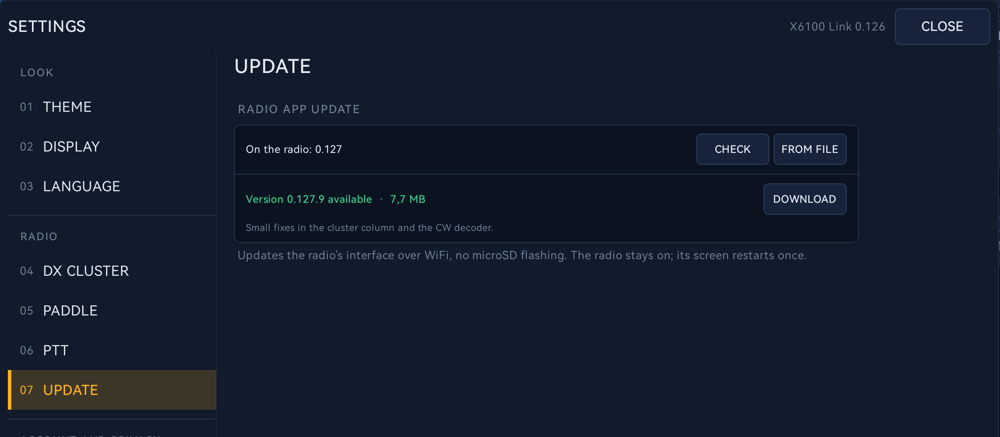

   

2. From the radio itself, when it is on the internet (WiFi or Ethernet):
   Settings > Update, App update line. Check asks x6100-link.it; with a new
   version the line says "Version X available: press Install." and the button
   becomes Install. Install shows "Downloading 3.1 of 7.7 MB", then the
   screen restarts once and the line says "Checking the new version...
   (2 min)", then "Version X installed.". Over WiFi the download can take a
   few minutes, with the Ethernet cable it is quicker.

   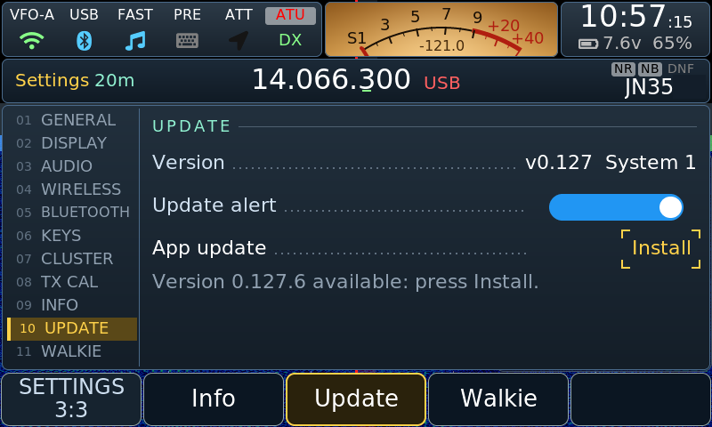

3. Web configurator (`http://<radio IP>/`), Update section: choose the
   package and press Install. The status line shows what the radio is doing.

   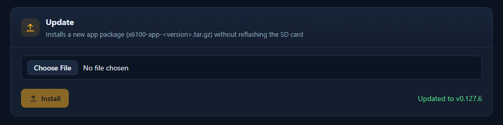

4. By hand: copy the package (from the versions page, or the one the app
   saved in the phone's Download folder) into the `update` folder of the microSD data
   partition (`/mnt/update/` on the radio) and switch on. At start the radio
   checks it, installs it and moves it to `/mnt/update/done/`, or to
   `/mnt/update/failed/` with a short text file that says why.


When it's done the radio shows "Update installed: version X". If the power
goes off during an install, or the new version doesn't start, the radio
restores the previous one and says so: "The update was interrupted. The
previous version has been restored." Nothing is lost.

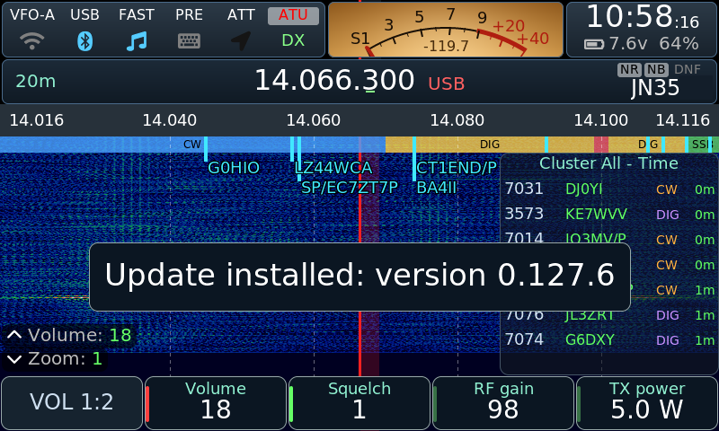

Messages and what to do:

| Message | What to do |
|---|---|
| This update needs a new microSD image. Please update by flashing the microSD card. | The version changes the system: rewrite the microSD, backup first |
| This radio can't update itself yet: flash image 0.127 or newer first | The radio is older than 0.127: rewrite the microSD once |
| The update did not start correctly / was interrupted / could not be installed. The previous version has been restored. | Nothing is lost: try again; if it happens again, rewrite the microSD and report it |
| This file is not an official update. Download it again from x6100-link.it. | Download the package again from the versions page |
| The update file is damaged. Download it again. | Download the package again |
| This file is not an update for the radio. / Choose an update file first. | Choose the `x6100-app-…tar.gz` file, not the SD image |
| Not enough space on the radio for the update. | Delete some recordings from the web configurator's Gallery |
| The radio stopped answering while the file was sent. | Check the radio is on and on the phone's network, then try again |
| Another update is in progress. Please wait. | Wait for the running update to finish |
| The upload was interrupted. / The update could not be checked. Please try again. | Try again; if it keeps happening, switch the radio off and on |

Rewriting the microSD always works, whatever the version, and it fixes any
problem the experimental update without the microSD might ever leave: by
choice, or when
an update gives trouble (the radio stays stuck, an update fails more than
once, the radio no longer connects). It starts clean and erases the whole
card, settings and logs included: download the Backup from the web
configurator first if the radio still works.

## Main screen

### Low battery

On battery, at 10% or less the radio shows a message every minute: "Battery
8%: about 15 min left" (the minutes when it knows them), and from 5%
"Battery 5%: connect power". At 6.0 V it shows "Low battery! Turning off in
30s" and switches itself off to protect the battery. As a guide, on my radio
receiving with WiFi and Bluetooth on, 10% left about 22 minutes and 5% about
12.

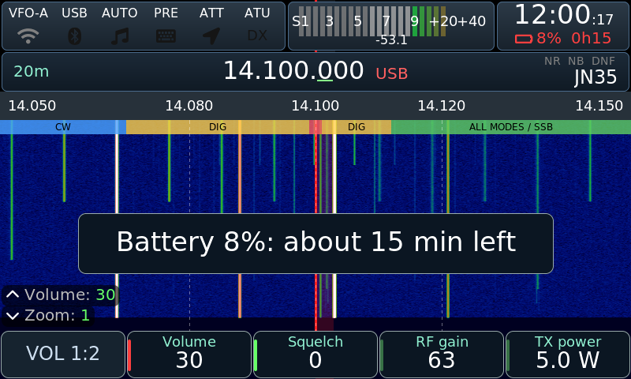

### Battery time

> **Experimental.** The time left is an estimate, not a measurement. The radio
> learns it by itself from how you use it, and it gets more precise over time.
> A "~" in front of the time means it is still learning.

At the top right the radio shows the charge and the time left:
- On battery: "45%  2h07", that is 45% of charge and about 2 hours and 7
  minutes before the battery is empty, if you keep using the radio the way you
  are using it now. While the radio is still learning, the time has a "~" in
  front: "~4h28".
- Charging: the lightning sign with "66%  ~3h05", the time still needed to
  reach a full charge.
- Charged and still on the external supply: "99%" with the power sign.
- External supply only, no battery fitted: the external voltage, "12.1v".

The "~" stays until the radio has seen at least 2 hours of discharge or 2 full
charges. Until then take the time as a rough guess.

<!-- IMG battery_estimate_main.png: top right, "45%  2h07" -->

How the radio works it out: there is no fixed table, it learns from how you
really use it. It weighs what draws current:
- receiving;
- transmitting, by watts and by seconds on the air;
- WiFi and Bluetooth;
- headphones;
- screen brightness.

The time shown follows what you did in the last 20 minutes. Every 20 minutes the
radio works its model out again and saves it on the microSD, so it is not lost
when you switch off. The more you use the radio, the closer the time gets to the
real one.

Limits:
- If you start transmitting much more than usual, the time drops fast. That is
  correct: the battery really is going down faster.
- While charging the time is less precise, because the base reports the charge
  in uneven steps while it charges.
- A battery that is getting old loses capacity. The radio follows the change
  after a few discharges, not at once.

The voltage is no longer at the top: read it in the POWER box of the
[Info tab](#info-tab). The battery log stays on the radio's microSD and is not
sent anywhere; if you send the diagnostics, they hold its last 5 lines.

### Status bar

The box at the top left of the main screen: the radio state on the first row,
the connections on the second.

| Item | Meaning |
|---|---|
| VFO-A / VFO-B | the VFO in use; SPL-A / SPL-B when split is on |
| USB-D, LSB, CW... | the mode |
| AUTO, FAST, SLOW, OFF | the AGC |
| PRE, ATT, ATU | highlighted when the preamp, the attenuator or the tuner is on |

Each icon of the second row is dark when off, grey when on but not connected
yet, in colour when working:

| Icon | Colour means |
|---|---|
| WiFi | green connected; grey on, no network; dark off |
| Bluetooth | blue a device connected; grey on, nothing connected; dark off |
| Note | blue Bluetooth headphones connected (A2DP) |
| Keyboard | amber a Bluetooth CAT client connected; grey CAT bridge ready |
| Arrow | green GPS position (fix in the last 10 s); grey GPS on, no fix |
| DX | green DX cluster connected; grey connecting or retrying; dark stopped |

In the middle is the [S-meter](#s-meter). On the right: the local time and the
charge with the time left (see [battery time](#battery-time)).

### S-meter

The S-meter shows the signal and its level in dB. Three options set its look.

Where: Settings > Display > MAIN SCREEN (also on the web configurator's
Display page).

| Option | Values | What it does |
|---|---|---|
| S-meter type | Bars, Needle | Bars: thin bars along the scale (default). Needle: a wide, low dial with a needle, in the theme's colours; the dB value is under the dial. |
| S-meter colours | Theme, Scale, Level | Theme: as the theme draws it. Scale: green, yellow and red along the scale. Level: the lit bars (on the needle, the arc up to the signal) in the colour of the signal level. |
| Needle lamp | on, off | An amber dial lit from behind, with dark marks and a red zone over S9. Needle only; it replaces the colours. |

The VISION theme always uses bars.

Per band S-meter calibration. Each band has its own correction, -40 to
+40 dB in 1 dB steps; the value shown is the one of the band the radio is on.
Where: Settings > General > CONTROLS > Per band S-meter cal.

- When you start editing it, a panel "S-METER CALIBRATION" says for 5 s:
  "For this band only. Feed -73 dBm and set the reading to S9 on each band you
  use. -22 dB matches an IC-7300."
- Change it only while reading a known signal: -73 dBm (S9) from a generator,
  or the same signal on a calibrated radio.
- A band never calibrated starts at -22 dB, or at the single S-meter cal value
  set before.

### Waterfall

Where: Settings > Display > WATERFALL.

| Option | What it does |
|---|---|
| Mode | Centered keeps the VFO in the middle; Fixed keeps the span |
| Auto level, offset | the levels follow the noise floor; the offset makes it darker or brighter |
| Min / max | the manual levels, used when auto level is off |
| Line, zoom | a line on the VFO; zoom with the waterfall instead of the span |
| Smooth scroll | scrolls by pixels instead of lines |
| Speed | 3 = 15 lines/s (default), 4 = 20, 5 = 30; 2 = 7.5 and 1 = 5 average the frames into a line: less noise and less CPU |

Over the waterfall. Where: Settings > Display > MAIN SCREEN.

| Option | What it does |
|---|---|
| Band plan | the band segments in a strip at the top |
| Cluster spots | the DX cluster calls at their frequencies (see [DX Cluster](#dx-cluster)) |
| Cluster column | the spot list in a box on the right |

Spectrum. Where: Settings > Display > SPECTRUM (off by default; the screen
restarts to lay it out). The band plan and the cluster spots stay at the top
of the waterfall. With Spectrum on, the card has:

| Option | What it does |
|---|---|
| Fill | the area under the trace filled |
| Peaks | the peaks held for a moment |
| Fill gradient | the fill fades from its colour at the trace to the background at the bottom |
| Filter colour | the filter passband on the spectrum and the waterfall: Theme (default), Blue, Cyan, Green, Yellow, Orange, Red, Violet, White |
| Height | the height of the spectrum, 60-160 px |

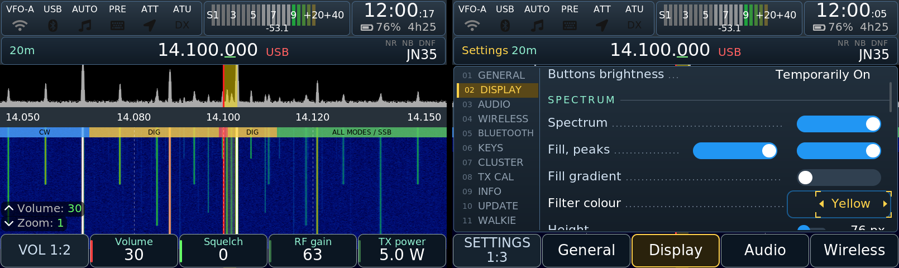

Colours, on the web configurator's Display page:

| Option | Values |
|---|---|
| Waterfall colours | Theme (default), Classic, Gauss, Grey, Fire, Ice, Rainbow |
| Trace colour | Theme, or your own |
| Fill colour | As trace, or your own (the trace is then drawn over it) |

### Screen recording

Records the screen and the audio to an AVI file (MJPEG video, 800x480,
8 frames/s, mono audio).

- Start and stop: APP 3:3 > Screen rec (the button reads Stop rec while
  recording), or a long-press action (screen rec on/off).
- Files: `/mnt/screenrec/screen-YYYYMMDD-HHMMSS.avi`. The web configurator's
  Gallery lists them and can convert them to MP4.
- While recording, the monitor level is raised (to at least 30) so your
  transmitted voice is recorded too. Your monitor setting comes back when the
  recording stops.
- File length: Settings > Audio > SCREEN REC > File length, 1 hour (default),
  45, 30, 15 or 5 minutes. When a file reaches that length it is closed and
  the recording goes on in a new file, named with the time it starts. Stop
  says how many files were saved. An hour takes about 2.5 GB.
- It needs the SD card and 50 MB free ("Screen rec: no SD card", "SD card
  full"). With less than 10 minutes of space left the radio shows "SD card:
  about N min left", again every minute; at 50 MB it stops by itself and closes the
  file properly ("SD card full, recording saved").

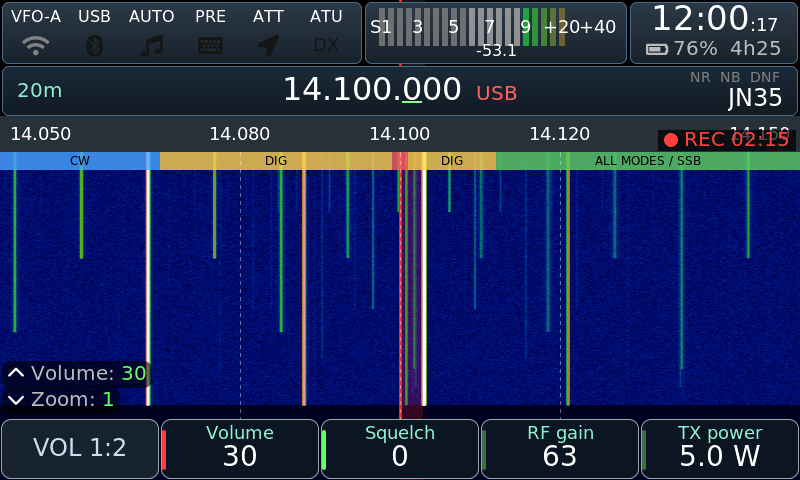

### Walkie Talkie mode

The radio held upright, the knobs on top, with a plain screen: VFO or memory,
RX/TX, frequency, mode, a bandscope, the S-meter, and the VOL, SQL and PWR
bars. It follows the theme.

- Bandscope: the band around the frequency, the same trace as the main
  spectrum (fill, peaks, colours, filter and VFO line), with the band edges
  in MHz and the span under it. The zoom is the main screen's. It runs also
  when the main spectrum is turned off.

Where: Settings > Walkie > WALKIE TALKIE > Walkie Talkie (or Settings >
General > CONTROLS > Walkie Talkie). The screen turns to portrait at once, no
restart.

> **How to leave Walkie Talkie mode**
> 1. Press **APP**: the walkie buttons appear on the left edge, the first one reads "(WLK 1:4)".
> 2. **Hold** that first button "(WLK 1:4)" (or press it three times): it goes to "(WLK 4:4)".
> 3. **Hold** the button **"Exit hold"** for a second. The radio goes back to the normal landscape screen.

- PTT: the PTT key on the side of the radio. It transmits with the built-in
  microphone (Settings > Walkie > Microphone); the border turns red and the
  S-meter shows the power and SWR. The microphone of Settings > Audio is back
  when you leave walkie mode.
- VOL knob: always the volume. The buttons that set a value use the MFK. When
  you leave walkie mode the VOL knob goes back to what it was on before.
- F1-F5 run down the left edge, with the buttons next to them. APP opens the
  walkie pages:

| Page | Buttons |
|---|---|
| WLK 1 | MEM/VFO, Band +, Band -, TX power |
| WLK 2 | AM/FM, SSB (held: DIG), ATU (held: tune, it transmits), PRE (held: ATT) |
| WLK 3 | AGC (held: split), A/B (held: copy), Step (held: back), Lock |
| WLK 4 | Store, Clear (held), Vol Sql RF Pwr (the levels page), Exit (held) |

- GEN, KEY, DFN, DFL and VM open their pages as on the main screen.
- Walkie channels: 32 channels of their own, apart from Channel Memory. Each
  keeps frequency, mode, AGC, PRE and ATT, like a memory.
  - MEM: the main knob steps through channels 1-32, the empty ones too. The
    panel shows "CH 05 - name", "CH 05" or "CH 05 - empty". A stored channel
    tunes the radio; an empty one leaves it where it is.
  - Store (WLK 4): the current frequency and mode go into the channel shown,
    and the knob switches to MEM.
  - Clear (WLK 4, held): empties the channel shown.
  - They are kept in /mnt/walkie_channels.json, the same format as
    channels.json with the channel number in "ch". A name can be written
    there; the radio shows it.
- Exit: APP, then WLK 4, hold "Exit hold" (steps in the box above). The screen
  goes back to landscape, no restart.
- Not in walkie mode: the apps, Settings and the hand mic keys. Leave walkie
  mode to use them.

## Settings

APP (page 2) > Settings. The tabs are on three button pages: General, Display,
Audio, Wireless (page 1); Bluetooth, Keys, Cluster, TX Cal (page 2); Info,
Update, Walkie (page 3).

The MFK walks the controls and stops at the first and last one. There the
page shows its top or its end, so status rows below the last control are
always in view. Some cards depend on the base firmware revision (TX AUDIO,
band output gain, TX filter, CESSB, FM emphasis): they are hidden when the
base is too old.

### General tab

| Card | Options |
|---|---|
| STATION | callsign, QTH locator |
| DATE / TIME | date, time, time zone |
| CONTROLS | Freq acceleration, Accel. onset, Charger (Off, On, Shadow), Per band S-meter cal, Walkie Talkie (see [Walkie Talkie mode](#walkie-talkie-mode)) |
| TRANSVERTERS | two transverters: from, to, shift |
| WFVIEW SERVER | on/off, user, password, server port and status, connected client |

Main knob acceleration. Where: Settings > General > CONTROLS > Freq
acceleration.

- The radio times every detent of the main knob, and the step grows smoothly
  with the speed.
- Turning slowly the step is the tuning step. Turning faster it grows up to
  6 times (Lite) or 15 times (Strong, which also starts sooner). None keeps
  the step.
- Accel. onset (1-5, default 3) sets how soon it starts: 1 only when turned
  fast, 5 already when turned gently.

Zone. Where: Settings > General > DATE / TIME > Zone. The change applies at
once; summer time follows by itself where the zone has it. 24 zones, UTC then
west to east: UTC, Pacific/Honolulu (HST), America/Anchorage (AKST/AKDT),
America/Los_Angeles (PST/PDT), America/Denver (MST/MDT), America/Chicago
(CST/CDT), America/New_York (EST/EDT), America/Sao_Paulo (BRT),
America/Buenos_Aires (ART), Europe/London (GMT/BST), Europe/Lisbon, Canary
(WET/WEST), Europe/Rome (CET/CEST), Europe/Athens (EET/EEST),
Africa/Johannesburg (SAST), Europe/Moscow (MSK), Asia/Kolkata (IST),
Asia/Singapore (SGT), Asia/Shanghai (CST), Australia/Perth (AWST), Asia/Seoul
(KST), Asia/Tokyo (JST), Australia/Brisbane (AEST), Australia/Sydney
(AEST/AEDT), Pacific/Auckland (NZST/NZDT).

Per band S-meter cal: see [S-meter](#s-meter). WFVIEW SERVER: see
[wfview server](#wfview-server).

### Display tab

| Card | Options |
|---|---|
| BACKLIGHT | timeout and brightness, buttons brightness (Always Off, Always On, Temporarily On) |
| SPECTRUM | Spectrum; with it on Fill, Peaks, Fill gradient, Filter colour, Height (see [Waterfall](#waterfall)) |
| WATERFALL | see [Waterfall](#waterfall) |
| MAIN SCREEN | Band plan, Cluster spots, Cluster column, Broadcast names, S-meter type, S-meter colours, Needle lamp |
| INTERFACE | Popups Freq/Info/ALC, Knob info, Theme, Font, FT8/FT4 info |

- Popups Freq/Info/ALC: a big frequency while tuning, a big value of the
  control being changed, a big ALC reading while transmitting.
- Knob info: the value shown while a knob turns.
- Theme: see [Themes](#themes). A new theme applies at once, without a restart.
- Font: Sony Sketch, Roboto or DejaVu (default). A new font applies at once.
  Themes with their own font (RS, Black Metal, Total Black) keep it.
- Broadcast names (from v0.127): tuned to a broadcast station on the air,
  the frequency strip shows "BC <station name>" in a light blue box instead
  of the band name. The names come from the broadcast list (see the
  [Update tab](#update-tab)).

All these options are also on the web configurator's Display page.

### Audio tab

| Card | Options |
|---|---|
| RX AUDIO | Speaker mode, Line-in / Line-out, Play / Rec gain, Boot sound (CQ CQ in CW with the boot logo, quiet; at volume 28 when your VOL is lower; off by default) |
| TX AUDIO | compressor (threshold, makeup), TX filter, FM pre/de-emphasis |
| MICROPHONE | Input (Built-in, Hand, Auto), Hand mic gain, Built-in gain |
| VOX | On, Gain, Anti-VOX, Delay |
| AGC | Hang, Knee, Slope |

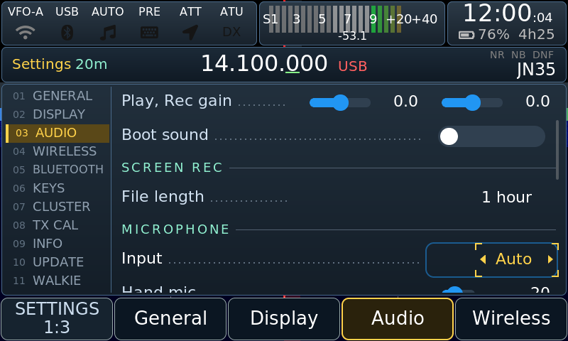

### Wireless tab

| Card | Options |
|---|---|
| WIFI | power, status, IP, networks |
| ETHERNET | a USB Ethernet adapter: DHCP or a static address (see [Ethernet](#ethernet)) |

WiFi/BT power switches the WiFi and Bluetooth chip (one chip for both): with
it off, Bluetooth is off too. Bluetooth has its own tab.

### Bluetooth tab

| Card | Options |
|---|---|
| ADAPTER | Bluetooth (power), Status, Address, Pairing (3 min) |
| DEVICES | Scan (headphones and keyboards, 16 s), Activity, the device list |
| HEADPHONES | RX to headphones, Volume, Mute speaker |
| BLUETOOTH CAT | Clients connected, Port |

- Status: *on* and hidden (paired devices connect, nobody else can pair),
  *pairing* while the pairing window is open, *off*. With the WiFi/BT chip
  switched off in Wireless it says so; if the Bluetooth service on the radio
  stops it says that too, and the page picks it up again when it is back.
- Pairing (3 min): the radio is visible and pairable for 3 minutes, the label
  counts down. Outside the window every pairing request is refused.
- The list: paired devices first, then what Scan found. Tags: *headphones*,
  *keyboard*, *phone*, *CAT* (a PC or other CAT client), *new* (not paired
  yet), *connected*. When a scan moves the devices around, the MFK stays on
  the device it was on.
- MFK press on a *new* device: pair and connect (headphones in pairing mode;
  for a keyboard press its pairing key). A keyboard that never sends its
  name shows as *Keyboard* and its address. Activity says what is going on:
  the code to type on a keyboard (then Enter), or "not found - is it in
  pairing mode?".
- MFK press on a paired device: a menu with Connect or Disconnect, Connect at
  startup (headphones) and Forget. Forget asks again (Cancel is first); after
  it the device has to be paired again.
- One pair of headphones at a time: connecting one disconnects the others. A
  keyboard and a CAT phone stay connected.
- Details: [Bluetooth headphones](#bluetooth-headphones), [Bluetooth CAT](#bluetooth-cat).

### Keys tab

| Card | Options |
|---|---|
| FRONT KEYS, LONG PRESS | the long-press action of GEN, APP, KEY, MSG, DFN, DFL (see [Buttons and knobs](#buttons-and-knobs)) |
| HAND MIC KEYS | F1, F2, F1 long, F2 long |
| PADDLE | USB paddles: Connected, the dit/dah of each kind, Learn dit and dah, Swap dit and dah, Serial port (see [USB paddle](#usb-paddle)) |

### Cluster tab

| Card | Options |
|---|---|
| CLUSTER FILTERS | Modes (CW, SSB, DIG, AM/FM), Bands (160-6 m), Activity (POTA, SOTA, WWBOTA, HOTA; none lit = all spots) |
| CLUSTER VIEW | Newest first, All bands, Spot snap hold, Spot snap speed |
| PSK REPORTER | Report decodes (on by default) |

What they do: see [DX Cluster](#dx-cluster).

### TX Cal tab

| Card | Options |
|---|---|
| TX CALIBRATION | IQ offsets, band output gain, codec gain |
| CESSB | on, level |
| TX PROTECTION | SWR protection |

SWR protection. Where: Settings > TX Cal > TX PROTECTION > SWR protection.

- Off, or the highest SWR allowed, 1.5 to 5.0 in steps of 0.5. Default 2.0.
- When the SWR stays over it for 0.3 s, the transmission stops and the radio
  says "TX stopped: SWR 3.4". Short spikes at key-up don't count.
- Not while the ATU tunes: the tune carrier sees a high SWR on purpose.
- Nothing stays locked: the next PTT or transmission goes out again.
- It stops what the radio keys itself: CAT PTT, the PTT button, CW messages
  and the CW keyboard, voice messages, the digital apps and the keyboard
  paddle (it keys again after both paddles are let go). A PTT held on the
  hand mic, VOX and the radio's own CW keyer may key again at once: let go
  and check the antenna.

Stuck TX. Now and then a command from the radio to its base (the board that
transmits) does not get through, and a lost PTT off could leave the radio
keyed. The radio watches for it; there is nothing to set.

- If the base is still in TX 2 s after PTT off, and a command to it failed in
  the 10 s before, the radio sets the TX power to 0. Your power comes back as
  soon as the base is back in RX.
- A PTT held on the hand mic and VOX are never cut: the base keys them itself.
- Each case goes into the base log, which is part of the
  [diagnostics](#info-tab):
  - "write to register N failed: N resent OK, N lost; resending all
    registers"
  - "base still in TX 1000 ms after an un-key or write error, nothing keying it
    from the GUI: PTT off resent"
  - "base still in TX 2000 ms after PTT off and a write error: TX power set to
    0 (vext 13.8 V, vbat 8.2 V)"
  - "base back in RX: TX power 5.0 W restored (vext 13.8 V, vbat 8.2 V)"
  - "base silent for N ms, battery 8.2 V, external 13.8 V": the base sent
    nothing for more than 0.3 s. Not in the first 10 s after start, at most
    one line every 10 s.

### Info tab

The FIRMWARE card: the author, the baseband version and Diagnostics, Send...,
which sends a diagnostics text to IU1WXY to help with a problem, and the
factory reset (below). The firmware version and the update options are in the
[Update tab](#update-tab).

Diagnostics. Where: Settings > Info > FIRMWARE > Diagnostics.

1. Ask IU1WXY first. The text is accepted only while IU1WXY has opened
   reception for it.
2. Press Send... The radio collects the text and shows it on screen first.
   The MFK scrolls it; a press or Send sends it, ESC or Cancel closes it.
3. After sending, the row shows a code. Tell IU1WXY that code.

The text has the versions, uptime and memory, the Bluetooth controller and
devices, the last pairing log, the input devices, the kernel messages about
Bluetooth, HID, USB and WiFi, and:

- Storage: free space on the card and its errors.
- Power: the last 5 lines of the battery log.
- GUI restarts since the radio was switched on.
- WiFi link: signal, speed, how many times it connected and dropped; no
  network names, and the addresses masked.
- The base log (write errors, resends, stuck TX: see
  [TX Cal](#tx-cal-tab)).

It has no position and no logbook. The first time, a short note explains what it is for: it is read
only by IU1WXY and deleted within 90 days.

| Message | Meaning |
|---|---|
| sending... | the radio is sending the text |
| sent, code XXXXXX | received; tell IU1WXY the code |
| not accepted now: ask IU1WXY first | reception is closed |
| too many today, try tomorrow | the daily limit is reached |
| probably sent, don't resend | the text went out but the answer did not come back. For 6 s the radio also says "Probably sent. Don't send it again; we'll get back to you." |
| refused by the site, try later | the site did not take it |
| no internet, check WiFi | the radio could not reach the site |

Factory reset (from v0.127). Where: Settings > Info > FIRMWARE > Factory
reset, Reset.... A panel lists what goes and what stays; hold the MFK down for
3 seconds to confirm, ESC cancels ("Released: reset cancelled"). A press or a
turn of the knob does nothing. Then the radio software restarts (a few
seconds of dark screen); the radio does not reboot.

> **There is no undo.** Download the Backup from the web configurator first,
> so you can put your settings back.

- Reset: all the settings in params.db (band memory and CW messages
  included), app frequencies, DX cluster, FT8 UDP, PSK squelch, wfview, time
  zone, headphone volume, Bluetooth CAT.
- Kept: logs (ADIF, QSO, field), memory channels, PSK/Olivia macros, JS8
  texts, voice messages, pictures, recordings, themes, CW trainer progress,
  Bluetooth pairings and autoconnect list.

POWER, below Factory reset, has three lines:
- Battery: voltage and charge, for example "7.9 V  66%", or "not fitted".
- External: the external supply and whether it is charging, for example
  "12.1 V  charging", or "none".
- Time left: what the [battery time](#battery-time) is based on, "learned from
  N h on battery, M charges", or "starting values, learning" while it has
  nothing of its own yet.

<!-- IMG settings_power.png: Settings > Info, POWER box -->

### Update tab

- Version: the firmware version and, next to it, the system ("System 1").
- Update alert: a message at start when a newer release is out.
- App update: Check asks x6100-link.it for a new version; when there is one
  the button becomes Install. The line below says what the radio is doing.
  See [updating the firmware](#updating-the-firmware).
- Remote updates (on by default): to fix a problem on a specific radio, the
  developer can send it a signed update. The radio installs it only when it is
  idle (receiving, no app or menu open, not in walkie mode) and shows a notice.
  Turn Remote updates off if you don't want this.
- Broadcast list, Update: the timetable of the broadcast stations (EiBi,
  eibispace.de) for the current season: A from the end of March to the end of
  October, B for the rest of the year; if the new season is not out yet the
  previous one is used. The note below shows the list in use ("In use: season
  A26, updated 2026-10-17, 9,593 stations."). Update downloads it over WiFi or
  Ethernet ("Downloading 0.3 of 0.5 MB") and says "Broadcast list updated:
  9,593 stations, season A26."; with no connection, "No internet connection.
  Connect the radio to WiFi or Ethernet."; if the download fails, "The
  download failed, the old list is still in use." The old list stays as a
  spare copy. The SWL panel (GENE key of the hand mic) and the station name on
  the frequency strip use the new list at once, without a restart.

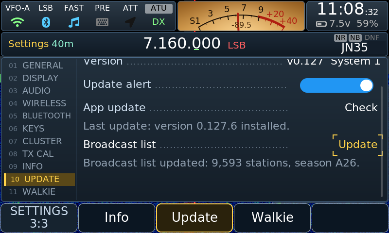


### Walkie tab

| Card | Options |
|---|---|
| WALKIE TALKIE | Walkie Talkie, Main knob steps channels, Microphone |

- Walkie Talkie: turns the portrait screen on. Settings closes and the walkie
  screen comes up (see [Walkie Talkie mode](#walkie-talkie-mode)).
- Main knob steps channels: the main knob goes through the walkie channels
  instead of tuning. The same as the MEM/VFO button on WLK 1.
- Microphone: the input used while the walkie screen is up (Built-in, Hand,
  Auto; default Built-in). The Audio tab's input is not changed.

## Transmitting

### Digital-mode TX level

The apps that transmit from the radio (FT8/FT4, JS8, WSPR, SSTV, RTTY,
WeFax) set their audio level by themselves.

- The level settles with the ALC working a little (about 1), with the power
  at the setting.
- In the first second or so of a transmission nothing changes. Then, while
  the ALC reads under 1, the level goes up slowly and stops there; when the
  ALC goes over 3 or the power is well over the setting, it comes down.
- The level found is kept for the next transmission.

TX power while a digital app is open:

- The power is capped at 7 W. With a higher setting the app says so
  ("Power is limited to 7W"), and the setting comes back when you close it.
- The Power button in the apps sets the power: 0.5, 1, 2, 3, 5, 7 W.
- Digital apps reopen on their last frequency and mode.

### ALC in CW

In CW and CW-R the ALC bar of the TX panel is grey. In CW the base makes the
carrier itself and its own ALC brings it down to the power set, so the bar
only shows how much it turned it down. Readings around 5 on a dummy load are
normal; there is nothing to adjust.

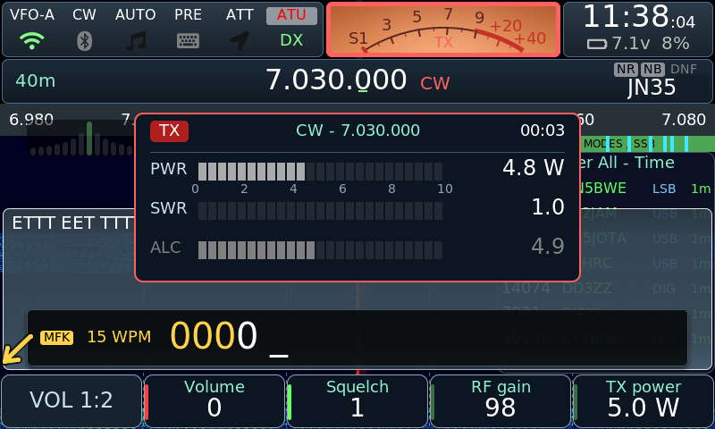

### Recording voice messages

**Voice messages can be recorded only from the hand mic.** The built-in
microphone cannot record them. This is a limit of the radio's baseband, not
of this firmware: the baseband keeps the built-in microphone off while
receiving and turns it on only when transmitting.

- It applies to MSG > Voice (Rec) and to the Field Ops voice CQ (Rec CQ).
- With no hand mic, after 3 seconds the radio says "No audio: recording uses
  the hand mic".
- Transmitting with the built-in microphone works as usual (Settings > Audio
  > MICROPHONE), also in Walkie Talkie mode.
- The recording keeps 250-3000 Hz, what SSB sends, without the radio's own
  hum and whistles.

## Digital modes

### Opening a mode

APP (page 1) > Modes opens a menu: RTTY, PSK31, PSK63, FT8, FT4, FT2, WSPR, Olivia,
JTTY, JS8, SSTV, WeFax, NavTex. Turn the MFK to choose, press to open; the last used mode is marked.
Pressing Modes again closes the menu.

- Callsign and QTH: Settings > General > STATION.
- The apps reopen on their last frequency and mode.
- Power is capped at 7 W while an app is open (see
  [Digital-mode TX level](#digital-mode-tx-level)).

### FT8 and FT4

APP > Modes > FT8 (or FT4, FT2). The radio tunes an FT8/FT4/FT2 frequency; the band
keys step through the others. 80 px of waterfall (about two slots) sit above
the list. The main knob moves your TX audio offset.

Buttons:

| Page | Buttons |
|---|---|
| 1 | Show: All / CQ, Mode: FT8 / FT4 / FT2, TX CQ, TX Call |
| 2 | Hold Freq, Auto, Force QSO save, Power |
| 3 | CQ Modifier, Time Sync, Log Map, Live Map |
| 4 | Freq: Preset / 14.091, Hound: Off / On, Retries, For you |

- Show: CQ shows the CQs and the messages to you; All shows all traffic.
- TX CQ calls CQ. TX Call allows or stops transmitting; stopping cuts a
  transmission in progress.
- Hold Freq: your TX offset does not move to the station you answer.
- Auto: the next message of the QSO is sent by itself, and a station that
  calls you gets an answer, also while you call CQ (what other programs call
  "Res"). It never calls a CQ on its own. If several stations call you in the
  same slot and one is a POTA activator, that one is answered first.
- Retries: how many times a message goes out with no answer before the QSO is
  dropped. Each press steps 3, 4, 5, 6, 8, 10, 12, 15 and back to 3; 6 by default.
- Time Sync: rounds the clock to the nearest slot (15 s FT8, 7.5 s FT4, 3.75 s FT2).
- CQ Modifier: for example `CQ POTA` or `CQ DX`.

The list. Each row has the slot time, the message, and on the right the
country with its flag, the distance (when the sender sent a grid and your
QTH is set) and the SNR. The country comes from AD1C's cty.dat (SP2KMO's
upstream PR #282). Settings > Display > INTERFACE > FT8/FT4 info picks what
goes next to the SNR: km, mi, Country, Country + km (the default) or
Country + mi.

| Row | Colour |
|---|---|
| CQ, not worked | green |
| CQ, worked on another band or mode | dark green |
| CQ, worked on this band and mode | darker green, struck through |
| a message to you | red |
| your TX | blue |

A POTA tag after the message marks a station spotted on POTA right now, and
any `CQ POTA`. The spots are the ones the cluster already fetches from
pota.app; with no spots there is no tag.

Replying. Turn the MFK onto a row and press it. The radio
answers that station, moves your TX offset there (unless Hold Freq is on) and
turns TX Call on. A press while transmitting stops TX.

The "For you" strip. Stations that call you stay pinned in a strip under the
list, so they do not scroll away.

- Up to 3 stations, one row each, newest at the bottom.
- A row stays 2 minutes after the station's last message. It leaves earlier
  when you send that station RR73 or 73. A band or mode change clears it.
- An MFK press on a row replies, as in the list.
- With the MFK: down past the last row of the list enters the strip; up from
  its first row goes back to the list.
- For you (page 4) turns the strip off: no pinned rows, the calls to you stay
  in the list only, in red as before. On by default.
- The strip has no title: a line in the "to you" colour sits on top of it.
  It is hidden when empty.

Log. A QSO is logged by itself when the other station sends R+report or
RR73 and both reports are known; "Force QSO save" logs by hand. The log is
`/mnt/ft_log.adi`; the radio says "Saved QSO de ...".

Log Map. Page 3 > Log Map shows the logged stations on a world map centred on you:
great-circle paths, a dot and the callsign for each station. Calls and dots
are larger since v0.119. ESC or Log Map closes it.

Live Map. Page 3 > Live Map puts on the same map every station decoded in
the last 15 minutes that sent a grid (a CQ or a reply with its 4-character
square). The dot's colour is the distance from your QTH square: green under
1000 km, blue under 3000, orange under 8000, pink beyond. Stations heard in the
last minute have a bigger, ringed dot and their call first; a call is left out
where it would cover another. A band change empties it. Your own position is
the centre of your 4-character square, the red dot. ESC or Live Map closes it;
the map is a snapshot, open it again to refresh.

PSK Reporter. Settings > Cluster > PSK REPORTER > Report decodes (on by default)
sends what you decode in FT8, FT4, FT2 and JS8 to pskreporter.info, the way
WSJT-X does: UDP to report.pskreporter.info:4739, batched about every 5 minutes
(up to 30 s earlier or later, at random), each call once per band in 5 minutes.
Your callsign goes with your QTH square cut to 4 characters (JN35, never the
6-character locator) and "X6100 IU1WXY v0.xxx" as the software; each spot
carries the call, its grid when the message had one, dial + audio frequency,
SNR and mode. Your own transmissions are never reported. With no network the
batch is dropped quietly; nothing waits on it, the decoding goes on. Search
your call on pskreporter.info to see the spots after a few minutes.
In PSK31, PSK63 and Olivia the text is free, so a station is reported when the
decoder reads "DE <call>" (as in "CQ CQ DE IK1ABC"), with no grid and 0 dB SNR,
because these modes give no S/N figure.

FT2. FT2 (IU8LMC, 2026) is FT4 at twice the speed: 41.67 Bd, 103 symbols in
2.47 s, 167 Hz wide, 3.75 s slots. Mode cycles FT8 > FT4 > FT2; the band keys
step through the FT2 frequencies (1.843, 3.568, 5.360, 7.062, 10.144, 14.084,
18.108, 21.144, 24.923, 28.184, 50.316 MHz). A transmission starts only in the
first 0.8 s of its slot, so that it ends inside it; the "RX" line comes every
4th slot (15 s). QSOs are logged as ADIF MFSK / FT2. From SP2KMO's upstream
port. The knob moves the TX offset 5 or 10 Hz a click when turned fast again
(4 or more clicks in 30 ms), from randal007's upstream fix.

WSJT-X UDP output. While the app is open the radio sends WSJT-X compatible
UDP messages (heartbeat, status, decodes, logged QSOs), so GridTracker or
JTAlert can follow it. From SP2KMO's upstream PR #275. It is set in
`/mnt/ft8_udp.conf` (`enabled=`, `host=`, `port=`, `id=`); the defaults are
port 2237 and the network gateway (your phone on a hotspot) plus the WSJT-X
multicast group.

Custom frequency. DXpeditions often work away from 14.074, e.g. H49A on
14.091. Page 4 > Freq lists the mode's preset frequencies, one per band: pick
one with the knob and press. Hold Freq for the keyboard: type the dial frequency in kHz
(14091) or MHz (14.091) and press Enter. The radio goes there in USB-D, the
rows say "RX FT8 Custom 14.091" and the button shows 14.091. It is kept for
the next time. An empty entry, a band key or a Mode change goes back to the
preset list. Range 1800 - 54000 kHz. The web remote's "base" reports it.

Hound mode. For an FT8 DXpedition in Fox and Hound mode (FT8 only). Page 4 >
Hound: On, then select the Fox's CQ and press. The rules are WSJT-X's (K1JT
and the WSJT-X team, GPL v3):

- You call "FOX YOURCALL GRID" in the second period (:15 and :45). Below
  1000 Hz is the Fox's: if your offset is lower it jumps to 1000-3000 Hz at
  random. Calling stops after 2 minutes; press the CQ again to go on.
- The Fox answers alone or inside a multi-stream message, e.g.
  "K1ABC RR73; YOURCALL <H49A> -12". You send "FOX YOURCALL R-xx" with the
  Fox's SNR, first on the Fox's own offset, then 300 Hz away from it.
  It stops after 11 periods (165 s) without RR73.
- The Fox's RR73 ("YOURCALL RR73; ..." or "YOURCALL FOX RR73") logs the QSO
  and TX stops. Decodes from the second period (other Hounds) are ignored.
- TX CQ and Hold Freq do nothing in Hound mode. The RX rows show the state,
  e.g. "Hound: calling H49A". Hound is off each time the app opens.

The multi-stream messages are now decoded in any FT8 session (ft8_lib left
them out); the Fox's call shows as `<...>` until its CQ has been heard.

SuperFox. Not supported. The SuperFox signal (WSJT-X 2.7) is a 1500 Hz wide
polar-coded waveform. Its code tables in WSJT-X are licensed for WSJT-X only
("NOT free software ... no derived work" without IV3NWV's written
permission), so they cannot go into this firmware, and the Fox check is a
one-time code verified on an internet server. Old-style Fox and Hound works.

### JS8

A JS8Call-compatible decoder and keyboard in the radio, with all four speeds
(Normal, Fast, Turbo, Slow) decoded at once.

First steps:

1. Set callsign and QTH in Settings > General > STATION. JS8 will not send
   without a callsign.
2. The radio clock must be within about 2 s: WiFi sets it, or use Time Sync
   (page 3) after some stations have decoded. It shifts only JS8's own
   timing (a drift shown on the top line); hold the button to reset it.
3. APP > Modes > JS8. The radio tunes the nearest JS8 frequency; the band
   keys step through JS8Call's (or GhostNet's) frequencies, or type your own
   (Freq, page 6). While JS8 is open the RX filter is 200-3000 Hz, noise
   reduction, noise blanker and notch are off, and power is capped at 7 W;
   all go back when you leave.
4. Turn the MFK onto a station's row, then HW CPY? (page 1), Reply (page 2)
   or Query > (page 1).
5. ESC or the top knob stops sending; the next ESC leaves the app.

Nothing sends by itself: AUTO (automatic replies), HB (heartbeats) and HB ACK
are off every time the app opens.

Buttons (the first one of each row turns the page, hold to go back):

| Page | Buttons |
|---|---|
| 1 | CQ (hold: auto CQ), Heartbeat, Query >, HW CPY? |
| 2 | Show: No HB / Directed / All, Reply, Send..., Clear |
| 3 | Time Sync, Hold: Off / On, Show Stations / Messages, Inbox |
| 4 | AUTO, HB, HB ACK, Settings... (INFO, STATUS, Relay, Groups) |
| 5 | APRS >, Log QSO, Activ.: Off / POTA / SOTA, Log prompt |
| 6 | Alerts >, Speed, Decode: All speeds / My speed, Freq: JS8 / GhostNet / kHz |
| 7 | Power, Map |

What it does:

- One-press messages (SNR?, GRID?, INFO?, STATUS?, HEARING?, AGN?, RR, 73),
  an Inbox for `MSG` messages, relays and store-and-forward like desktop
  JS8Call.
- Log: the Log popup (page 5, or when a QSO ends with 73/SK) saves to
  `js8call_log.adi` in desktop JS8Call's ADIF format, with POTA/SOTA
  activation fields. FT8 keeps its own `ft_log.adi`.
- Map (page 7): the stations of the JS8 log on the same map as FT8.
- Alerts: beeps for messages, CQs and new stations, and purple alert words.
- APRS through JS8 gateways: grid and GPS position beacons (optionally with a
  message), POTA and SOTA spots, SMS, email and Winlink.
- Rows in the list: blue sent by you, red to you, green a CQ, dark blue to a
  group, purple an alert word.

The @X6100 group, for stations running this firmware. It is in Groups by
default, and everyone is free to take it out:

- Messages to @X6100 show in red like those to you, also under Show: No HB
  and Directed. In Show Stations, a station heard sending to @X6100 gets a
  small X6100 tag at the end of its row. While you are in the group, a MSG
  to @X6100 goes in the Inbox.
- The radio never transmits to the group by itself: no automatic answers,
  heartbeat acks, ACKs or relays for @X6100 traffic, with AUTO on or off,
  in the group or not. Only what you send yourself goes out.
- To leave it: page 4, Settings..., Groups: @X6100. Delete @X6100 from the
  text and confirm; the radio shows "No groups" (or your other groups). It
  stays out after that, also after a restart or an update. To join again,
  type @X6100 there.

Known limits: relays, store and forward, and most APRS items are not yet
proven on the air (only the grid spot and SMS are). The main screen's
waterfall stands still while JS8 is open.


### WSPR

APP > Modes > WSPR. The radio tunes the nearest WSPR dial frequency (USB-D,
WSJT-X's list); the band keys step through the others. Cycles are two minutes
from the even UTC minute, so the clock must be right to about a second (GPS
or NTP).

- RX: every cycle not used for TX is decoded at 1:54. The spots go to the
  top of the table (UTC, SNR, DT, audio Hz, drift, call, grid, dBm, km from
  your QTH).
- TX % (0, 10, 20, 33, 50): the chance that a cycle is a beacon, chosen at
  random as in WSJT-X. TX next sends one beacon in the next cycle; press
  again to stop it, also on the air.
- The message is the callsign, the first 4 characters of the locator and the
  power (at most 7 W, rounded to a WSPR level). Compound calls with a `/`
  can't be sent.
- The main knob moves the TX audio offset (1410-1590 Hz).
- Upload: the spots of each cycle go to WSPRnet (plain HTTP over WiFi). The
  status line counts what was sent and what failed.
- Page 2: Power and TX n%, the same 0, 10, 20, 33, 50 steps as on page 1.

### SSTV, WeFax and NavTex

These apps work on known frequencies, so they don't need the waterfall. They
fill the screen in the same look as WSPR, and Freq. opens the list to tune
from (the MFK chooses, a press tunes). The header shows the station or
frequency and the receiver state. Leaving the app gives the VFO back.

- NavTex: NAVTEX 518 and 490 kHz, NAVTEX HF 4209.5 kHz and the HF MSI
  frequencies. The MFK scrolls the text.
- DSC (in NavTex, Mode: NAVTEX / DSC): receive only, MF/HF distress and
  safety calls on 2187.5, 4207.5, 6312, 8414.5, 12577 and 16804.5 kHz (Freq.
  lists them). One row per call, the newest on top: UTC time, category
  (DISTRESS, URGENCY, SAFETY, ROUTINE, ACK), the caller's MMSI with its
  country, then the nature of distress, ALL SHIPS or the called MMSI and the
  proposed mode and frequency. Distress rows are red, with the position and
  the time it was valid. A `?` marks a call whose error check failed. Save
  (page 2) writes the calls to the Files page.
- WeFax: DWD, Northwood and Athens stations. View (page 2) chooses Big
  (default), Full (the whole fax) or Small, the old low panel that keeps the
  main waterfall visible above it.
- SSTV: calling frequencies, LSB on 80 and 40 m (3.735, 3.845, 7.165,
  7.171 MHz) and USB above (14.230, 14.233, 18.160, 21.340, 24.975, 28.680,
  50.510 MHz). The picture is on the left, the decoder state on the right,
  the decoding progress in the thin bar under the header. The decoder is
  TheMurusTeam's 1KO125 beta8 one, with a tolerant VIS detection.

WeFax buttons. WeFax opens in RX Auto: it waits for the start tone of a fax.

| Page | Buttons |
|---|---|
| 1 | Freq., RX Auto / Cont, Clear, Close |
| 2 | Align, Tilt, View, Save |
| 3 | Fax Browser, Fix Align, Fix Tilt, Done |
| 4 | Power |

SSTV buttons:

| Page | Buttons |
|---|---|
| 1 | Start Auto RX, Start Manual RX, RX Mode (Manual RX), TX |
| 2 | Freq., RX Pics Browser, Delete picture, Auto RX Restart (on: a new VIS during a picture starts a new one) |
| 3 | Power, Denoise (ON/OFF), Close (ESC also closes) |

Denoise. SSTV 3:3 > Denoise, on by default. When a picture is complete the
radio saves it as it came off the air (`sstv-20261016-143205.png`), cleans
it and saves the clean copy next to it (`sstv-20261016-143205_dn.png`); the
screen shows the clean one. The clean-up removes the coloured dashes that
QRM and fading leave along a line and the single wrong dots, then evens out
the grain a little without softening edges. A picture without noise comes out
the same. Two limits: a line drawn only 1 pixel high goes with the noise, and
in Robot 36/72 a colour dash covers two lines, so it stays. It takes about
0.1 s per picture after the decoding; the live picture while receiving is
the raw one. With Denoise OFF only the original is saved. In the RX Pics
Browser, the web Gallery and the X6100 Link app both files are listed, the
`_dn` one first with the original right below it; delete either one on its own.

SSTV TX. TX opens the TX menu (turn the MFK, press to choose):

- CALL CQ: a picture with CQ CQ SSTV and your callsign on it.
- REPLY TO / REPLAY TO the target callsign: the reply text on a picture;
  Replay adds a miniature of the last received picture.
- TX IMAGE ONLY: the picture without text. REPEAT LAST TX sends the last
  transmission again.
- SET TARGET CALLSIGN: type the other station's call (Reply and Replay need
  it).

Then choose the picture, the text (templates like `R575QSB`, `PSEQSL`, `73`)
and its colours; the next press transmits.

- TX Mode chooses Martin, Scottie or Robot. Cancel TX goes back. Halt TX
  stops on the air.
- TX goes through the same player as FT8 and WSPR: power at most 7 W, level
  set from the ALC and the power.
- Pictures are in `/mnt/sstv/tx_pics`, text templates in
  `/mnt/sstv/tx_text`; the default ones are copied there at the first start.
  Received pictures are saved in `/mnt/sstv`.
- Pictures can be uploaded from the web configurator's Gallery or sent from
  the phone.

### PSK31, PSK63 and Olivia

Keyboard-to-keyboard modes, ported from SP2KMO's OpenX6100 PSK31 and Olivia
work (randal007's merge). APP > Modes > PSK31, PSK63 or Olivia. The radio
goes to the nearest standard dial frequency in USB-D (PSK 14.070, 7.040,
3.580...; Olivia 14.071, 7.071, 3.5815...); the BAND keys step through the
others. Frequency and mode come back when the app closes.

- The waterfall covers the receive filter; the coloured band is where the
  decoder listens. The main knob moves it (5 Hz a click in PSK, 10 Hz in
  Olivia); in PSK it snaps
  onto the signal underneath when the knob stops. The MFK gives 1 Hz (PSK)
  or 5 Hz (Olivia) steps.
- Received text in the panel under the waterfall, sent text in the TX
  colour; the size follows Settings > Display > Decoder text, as RTTY and CW.
- Mode (page 1): PSK31 (31.25 Bd) or PSK63 (62.5 Bd), same Varicode; Olivia
  8/250 (default), 16/500 or 32/1000. The status button shows the audio
  frequency and the lock quality; press resyncs, hold clears the text.
- PSK squelch (page 2, SQL): text is shown only while the decoder's quality
  (how tightly the symbols sit on 0 and 180 degrees, the Q on the button)
  is at the threshold or above, and for 1.5 s after it drops. Noise alone
  reads about 50 (never above 64 in the tests), a readable PSK31 signal 70 and
  more. On at 68 by default, so noise prints nothing. Press, then the MFK sets
  it (0 = off); hold toggles off/on.
  Olivia needs no squelch: it prints only once it has locked (a few blocks,
  about 8 s at 8/250).
- Dial (page 2): the MFK moves the VFO in 1 kHz steps, up to 50 kHz either
  side; hold goes back to the standard frequency.
- DX call and RST (page 2): the DX call is taken from "DE <call>" in the
  received text, or typed in; hold clears it.
- TX: Free Text, or the macros (pages 3-5: press sends, hold edits; an empty
  text deletes). Tokens `<MYCALL>`, `<CALL>`, `<RST>`, `<RSTR>`. Stop TX ends
  with a short carrier tail (PSK) or after the current block (Olivia). Nothing is sent on
  opening. TX goes through the same path as FT8: power capped at 7 W, ALC
  levelling, SWR protection, the TX strip.
- Files: `/mnt/psk_macros.txt`, `/mnt/olivia_macros.txt`, `/mnt/psk.conf`
  (squelch).
- The macros can also be edited on the web configurator's Macros page.

### JTTY

The keyboard mode added in WSJT-X 3.2 by K1JT and the WSJT-X team (ported
from WSJT-X, GPLv3). APP > Modes > JTTY. The radio goes to the JTTY dial
frequency of the band in USB-D (14.090 on 20 m). The layout is the same as
RTTY and PSK: received text in the panel under the waterfall, sent text in
the TX colour. F1-F8 (pages 2 and 3) are macros: press sends, hold edits
the name and then the text (an empty text deletes, the ones after move up).
By default they are the WSJT-X contest keys. In the text, `%M` is your call,
`%H` the DX call, `%E` "599" and the serial number, sent as one frame. Up to
80 characters, kept in `/mnt/jtty_macros.txt`, also on the web configurator's
Macros page. Decoded stations go to PSK Reporter when it is on. TX goes through the same path as FT8 (7 W cap, ALC, SWR
protection). I haven't made a QSO with it yet, so reports are welcome.

### RTTY and WeFax TX

RTTY and WeFax transmit only from the [X6100 Link app](#x6100-link-app); the
radio has no local TX button for them.

- RTTY TX: ITA2 AFSK with the RTTY app's rate, shift, centre and reverse,
  through the same TX player.
- WeFax TX: a picture in grey, 1809 px wide (IOC 576), 120 LPM, with APT
  start and stop tones and phasing, at most 800 lines. Pictures go to
  `/mnt/wefax/tx_pics` (uploaded from the phone or the Gallery).
- NavTex is receive only.

## CW

### CW decoder

In CW mode the decoder buttons are on the CW pages (CW 1:2, 2:2): Decoder
on/off, Tuner (tuning indicator), Dec SNR, CW peak and CW peak Q. Text and
speed (WPM) appear in the panel over the waterfall.

- The receiver comes from gdyuldin x6100_gui 1.0.1: a coherent tone tracker
  that follows the station inside the CW filter, a detector with a noise
  floor, and a time classifier that learns the speed.
- On test signals it copies 98-100% from 20 dB down to 0 dB SNR (in 2.5 kHz)
  and still 97-100% at -3 dB; the old decoder stopped at about +5 dB. The WPM
  reading is within about 0.5 WPM.
- Dec SNR (5-30 dB, default 8) is how far over the noise floor a mark must
  be. Lower copies weaker signals but can print noise.
- No characters from noise: lone blips, clicks and steady carriers (birdies)
  on the tone are not decoded and do not change the speed estimate.
- A letter shows when the next one starts; the last one after a short pause.
  For 1 s after the decoder is reset (first use, CW peak or key tone change)
  nothing is decoded. A key-down longer than 8 dots (tune-up) is ignored.
- Upstream bugs fixed here: a strong station slightly off tune was never
  decoded, and a dash cut by a retune came out as a dot.

Parse. Where: CW 2:2 > Parse (on by default). The decoder often runs words
together when the spacing is tight: "CQCQDEIU1WXYK". With Parse on, each
finished word is split on the usual CW words and on callsigns: "CQ CQ DE
IU1WXY K", "UR 5NN 5NN", "TU 73 <SK>", "NAME GIO". It only adds spaces,
never changes a letter, and leaves a word alone when it does not read
cleanly (ANTENNA stays ANTENNA). Callsigns show in the theme's accent colour
once confirmed: after or before DE, sent twice, or found on QRZ by X6100
Link. A call-shaped word heard once (often noise) stays plain. Abbreviations
and prosigns are dimmer, RST (599, 5NN) in the heading colour. A call
already on the panel decides a doubtful split: with W1AW sent before,
"DEW1AWK" reads DE W1AW K. Parse Off gives the text exactly as decoded.

### CW from the keyboard

With a USB or Bluetooth keyboard you key CW straight from the main screen.
Pair a Bluetooth keyboard in Settings > Bluetooth > DEVICES; it is found
again when it reconnects.

- It works in CW or CW-R, with the VFO inside a CW segment of the band plan
  (the CW part of the strip over the waterfall) and no app open.
- A letter or digit opens a thin line over the bottom of the waterfall with
  what you type. Backspace corrects, Esc clears it (and stops sending).
- Enter keys the line. Lines typed while sending wait in a queue. The line
  on the air is bright up to the key and highlighted after it, the queue is
  grey.
- On the left of the line, the yellow MFK tag with the key speed and an
  arrow to the corner: while the line is open the MFK turns the speed (the
  same as KEY > Speed), and goes back to its control when the line closes.
- When everything is sent the line goes away. Out of CW mode or out of the
  CW segment nothing new is sent and the line is cleared.
- F1 to F5 key the MSG > CW messages 1 to 5 (in list order) as if typed
  and sent with Enter; Esc stops them. An F key with no message does nothing.
- In a CW message `{CALL}` is your callsign (Settings > General > STATION),
  also with TX in MSG > CW; with no callsign set it stays as written.
- Until the line is open, the other keys (- = and so on) work as usual; in
  CW [ and ] are the paddle (below).

The X6100 Link app's CW tab uses the same keyer. Its F1-F5 buttons show
the start of the same five messages: a tap keys one with `{CALL}` filled in,
a long press edits it.

Live mode. The CW Keyboard app (opened from X6100 Link) has a switch on its
last page, "Live: On" / "Live: Off", off by default. The same setting drives
the CW line of the main screen.

- Live on: each letter is keyed as you type it, no Enter needed; a space is
  the word gap. The empty field reads "Live: keyed as typed".
- Backspace removes the last letter not keyed yet; a letter already on the
  air stays.
- Limits: there can be up to about 0.1 s of extra space between letters, and
  with a short QSK time the relay may click between them. Not yet tried on
  the air.

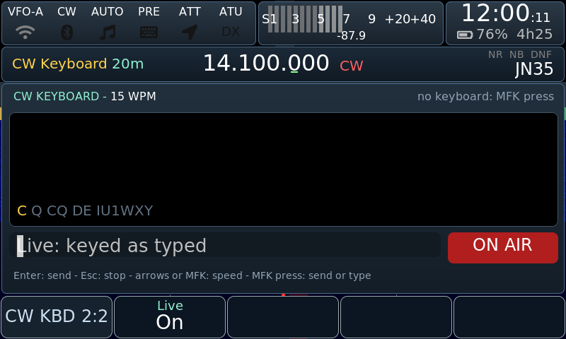

### TinyMIDI / Bluetooth paddle

The N6ARA TinyMIDI paddle works as a Bluetooth keyboard.

- Put its mode switch on the left (Keyboard Mode) and pair it in Settings >
  Bluetooth > DEVICES like any keyboard: it is a Low Energy one, the scan
  finds it as *keyboard*.
- In CW or CW-R the dit contact (the `[` key) and the dah contact (`]`) key
  the radio. Out of CW they are the volume keys again.
- It follows the KEY settings: Speed, Iambic A or B, the dit:dah ratio and
  the key mode: Manual makes the dit contact a straight key, Auto-R swaps
  the contacts. Train keys only the sidetone, as with a wired paddle.
- A touch of the paddle stops a CW message or line on the air, as a break.
- The touch paddle goes up to 30 WPM, a paddle on its 3.5 mm jack up to 40.
  Any USB keyboard's [ and ] keys do the same.

### USB paddle

USB paddle interfaces plug into the radio's USB port. The radio reads four
kinds:

- Keyboard type: the adapter sends keys. Default Left Ctrl = dit, Right
  Ctrl = dah (the Vail adapter); [ and ] always work too.
- Mouse type: the paddle shows up as a mouse, default left button = dit,
  right button = dah. An ordinary mouse is not taken for a paddle.
- USB MIDI (highly experimental): notes, default 1 = dit, 2 = dah.
- USB serial (CH340, FTDI, CP210x, PL2303, CDC ACM): the paddle on the
  modem lines, default CTS = dit, DSR = dah. Off by default: turn on Serial
  port. The first ttyUSB or ttyACM port is read; the radio's own ports are
  never touched.

In CW or CW-R the contacts key the radio; out of CW they do nothing. The
keyer follows the KEY buttons in CW (mode, iambic A/B, speed, ratio).

SET > KEYS > PADDLE shows what is connected and the dit/dah of each kind.
Learn dit and dah > Start, then press the dit contact and the dah contact:
whatever comes in (a key, a mouse button, a MIDI note, a serial line) is
saved for that kind. Each press has 10 seconds. Swap dit and dah exchanges
them for all the USB paddles.

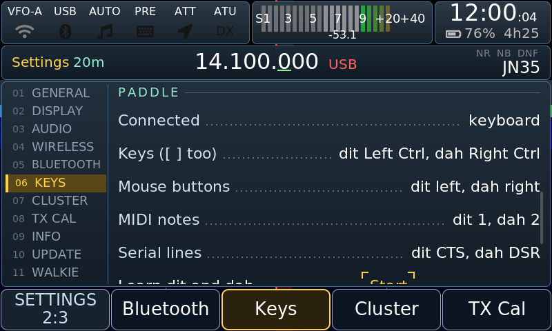

A keyboard-type paddle press stops a CW message on the air; the other kinds
do not.

### CW messages

The MSG > CW messages are sent with TX or as a beacon.

- Edit them on the radio (MSG > CW) or on the web configurator's CW messages
  page (Operating menu): add, edit, delete, 1-64 characters each. The radio
  shows the changes the next time MSG > CW opens.
- While a message or beacon is sent, the break-in delay is raised (one word
  space plus 150 ms, at most 1 s), so the transmitter stays keyed through
  the gaps instead of clicking the relay. It goes back to your setting between
  beacons and when the message ends.
- They also appear as macros in the X6100 Link app's CW tab.
- `{CALL}` is your callsign and `{HIS}` the other station's: on the radio the
  last call the decoder confirmed (the one Log QSO offers), in the app the call
  typed in the CW tab's LOG field, e.g. `{HIS} UR 599 599 BK`.
### CW Trainer

APP (page 2) > CW Trainer keys with the radio's own keyer, so it follows the
KEY settings. While it is open the radio is in train mode: sidetone only, no TX.

- KEY button, page KEY 2:2:
  - Mode: Manual is a straight key, only one paddle contact works. Auto-L and
    Auto-R are the iambic keyer for a paddle; L and R swap which side gives
    dits and dahs.
  - Iambic: A or B.
  - QSK time and Ratio are on the same page.
- With a paddle, set Mode to Auto-L or Auto-R before opening the trainer. On
  Manual only one side of the paddle keys.


## Apps

### DX Cluster

Needs WiFi (Settings > Wireless) and your callsign (Settings > General >
STATION), used to log in.

- The client connects in the background as soon as both are there. It
  reconnects by itself (with a backoff) after an error or when WiFi comes
  back.
- Spots older than 60 minutes are dropped. After login it asks for the latest
  50 spots (`sh/dx`).

Cluster app (APP > Cluster; pages `(CLUSTER 1:2)` and `(CLUSTER 2:2)`):

- The spots of the current band, sorted by frequency, with a VFO marker row
  among them. The list stays centred on the VFO: tuning scrolls it and
  selects the nearest spot. Spots within 3 kHz of the VFO are highlighted; a
  green `*` marks spots less than 2 minutes old.
- Turning the MFK browses the list (this stops the VFO following). An MFK
  press or the Tune button tunes to the spot. The mode comes
  from the comment (CW, FT8, SSB, ...) or else from the band plan: CW, USB-D
  on the FT8/FT4 frequencies, LSB below 10 MHz, USB above.
- Page 1: Band / All switches between the current band and all bands (always
  all when the VFO is outside the amateur bands); the button shows the view
  (`Band / 20m`, `Band / All`). Tune, Mode (All > CW > SSB > DIG, a quick
  view filter), Close.
- Page 2: Server opens the list of saved servers: MFK to choose, press to use
  it, Server again or ESC to close. The choice is saved in
  `/mnt/cluster.conf`. Order: by frequency around the VFO (`Freq`) or newest
  first (`Time`).
- Order and band view are saved and shared with the cluster column.
- The status line shows the WiFi and cluster state ("Set your callsign",
  "WiFi not connected", "Connecting...", "cluster connected", or the error
  and "retrying").

Logging a spot. When you tune a spot with the MFK (in the app or the cluster
column), the X6100 Link app opens its logger with the call filled in (see
[X6100 Link app](#x6100-link-app)).

Filters and alerts. They are saved in `/mnt/cluster.conf`, shared by the
radio and the web configurator, and apply to the app, the column and the
waterfall.

- On the radio: modes (CW, SSB, DIG, AM/FM), bands (160-6 m, all on = no
  filter) and activity (POTA, SOTA, WWBOTA, HOTA, any mix; none lit = all
  spots). One mode and one band always stay on. A change applies at once.
  Where: Settings > Cluster > CLUSTER FILTERS.
- POTA / SOTA come from the spot comment: the word POTA or SOTA, a park
  reference (`US-1234`, `IT-0123`) or a summit reference (`I/LO-123`,
  `W7W/KG-001`). WWFF references (`IFF-0123`) are not taken as POTA.
  WWBOTA: the word WWBOTA (or BOTA) or a bunker (`B/G-0070`); HOTA: the word
  HOTA or a HOTA reference (`RO-H0390`).
- Besides the cluster, the radio reads the activator spots of pota.app,
  wwbota.org and cqhota.app once a minute (WiFi needed) and puts them in the
  same list.
- On the web configurator (Cluster page): the same modes, bands and activity,
  plus maximum age and spotters to skip (`*` wildcard).
- Alerts (web configurator): callsigns or prefixes (`3B8M`, `VP8*`, `*/MM`),
  optionally only on some bands or one mode. Matching spots are magenta with
  an `ALERT` tag and are never filtered out. A new one pops up on the main
  screen for 10 s (an MFK press tunes it).

On the main screen. Where: Settings > Display > MAIN SCREEN.

- Cluster spots: a short cyan line at each spot frequency at the top of the
  waterfall (across the band plan strip), with the callsign under it, in two
  staggered rows on a dark see-through background. Alert calls are pink. The
  waterfall does not move.
- Cluster column: a box at the right of the waterfall (80 % opaque) with the
  spots (kHz, callsign, mode, age) around the VFO marker row, coloured by
  age: green under 2 minutes, yellow under 10, amber under 30, grey older.
  The title shows the view (`Cluster 40m - Freq`). In time order the newest
  spot is on top and there is no VFO marker row.
- While the column is shown, the MFK has two more items, Cluster order
  (Freq / Time) and Cluster bands (Band / All), the same settings as in the
  app.

Cluster view. Where: Settings > Cluster > CLUSTER VIEW.

| Option | What it does |
|---|---|
| Newest first | the same as Cluster order |
| All bands | the same as Cluster bands |
| Spot snap hold (0-5, 0 = off) | with the cluster spots shown, turning the main knob slowly stops the VFO on a spot it passes for this many more detents |
| Spot snap speed (1-5) | how slow counts as slow: at most this many detents every 33 ms. Turning faster goes past. |

Without the cluster spots on the waterfall there is no snap.

Servers. If `/mnt/cluster.conf` has no `server=` lines the app lists eleven
public clusters (DXFUN, VE7CC, W3LPL, K1TTT, NC7J, W1NR, WA9PIE, K4ZR,
DB0SUE, GB7DJK, AE5E). The default is DXFUN, `dxfun.com` port 8000. Add and
remove servers from the [web configurator](#web-configurator) or in the file
([format](#files-on-mnt)).

### Field Ops (SOTA / POTA)

A full-screen interface for portable activations: APP (page 2) > Field Ops,
or a long-press action. GEN or Radio goes back to the normal screen.

- Everything (the reference, the activation running, its log, the screen you
  were on) is kept on the SD card in `/mnt/field`. Coming back, or a restart
  in the middle of an activation, finds it as it was.
- Start here (home screen) opens Field Ops at power on.
- Re-spot (home screen, on by default): the automatic spot after a QSY. Off,
  the radio spots only when the activation starts, when you press Spot and
  the QRT at End.
- The main knob still tunes; the MFK chooses.

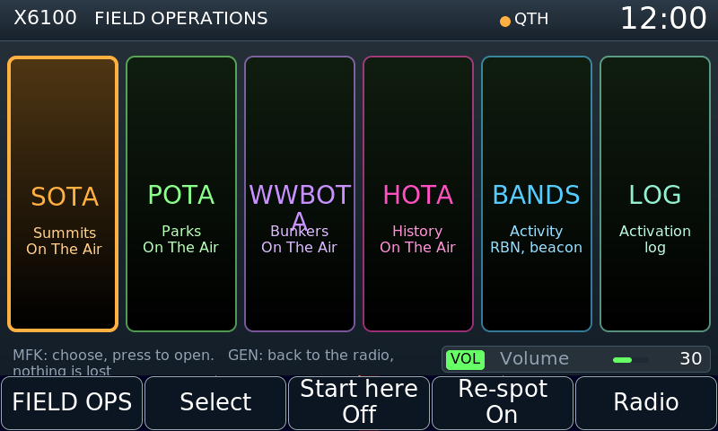

| Home | SOTA, before the activation |
|---|---|
|  |  |
| **Activation** | **Bands** |
|  |  |

Home: six tiles, SOTA, POTA, WWBOTA, HOTA, Bands and LOG. MFK to choose, a
press opens.

SOTA / POTA, before the activation:

- On the left the reference: summit or park, name, altitude and points
  (SOTA), locator, coordinates and where the position comes from. On the
  right the nearest references with their distance. The nearest one is
  taken; the MFK and a press choose another; Ref... (page 2) types one.
- The position comes from the radio's GPS, else from the phone (the X6100
  Link app sends it), else from the QTH locator. The dot in the header is
  green for a real position (GPS, phone), yellow for the locator.
- Update list (page 2) downloads the parks (POTA) and summits (SOTA); then it
  works offline. Also from the web configurator's Field Ops page. The radio
  says "Downloading the reference lists: up to 10 minutes on a slow WiFi",
  then each list with its progress, "Updating <list> (1/4): x.x / y.y MB",
  and "reading it..." once it is downloaded. A download that stops goes on
  from where it stopped, up to 5 tries ("retry 2 of 5"). At the end:
  "Reference list: N parks, N summits, N bunkers, N HOTA".

  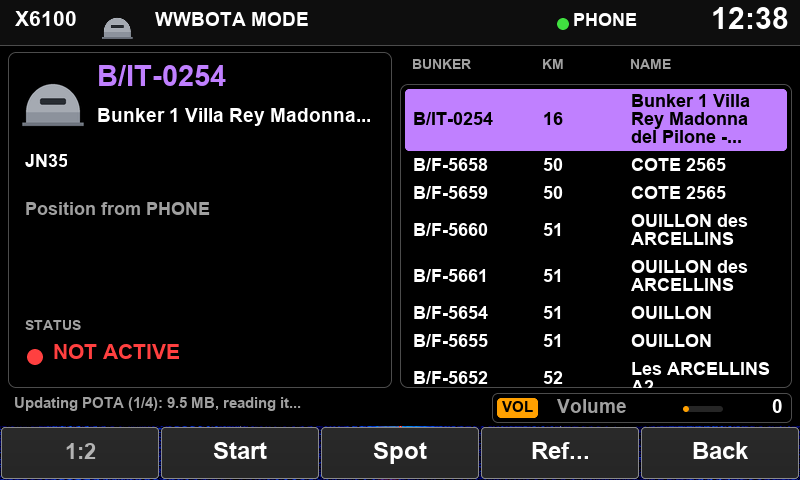
- Start begins the activation and its ADIF log.

SOTA / POTA, during the activation: the band, the frequency and the mode,
the S-meter, the CQ text with the reference, the QSO count, the time since
the start and the last call.

- CQ sends `CQ CQ SOTA DE <call> <call> K` in CW (POTA in a park). In SSB it
  sends your voice CQ: record it once with Rec CQ (page 2, before or during
  the activation): press, speak, Stop rec (60 s at most). It records from the
  hand mic only (see [recording voice messages](#recording-voice-messages)). It is `CQ SOTA` /
  `CQ POTA` in `/mnt/msg`, so MSG > Voice lists it too. CQ again while it is
  on air stops it.
- Log QSO: type `CALL`, or `CALL rst_rcvd rst_sent` (default 599 in CW, 59
  otherwise). Each QSO goes to the SD card at once, in
  `/mnt/field/logs/<date>-<time>_<ref>.adi` with `MY_SOTA_REF` or
  `MY_SIG POTA` / `MY_POTA_REF`. The logs can be downloaded from the web
  configurator's Field Ops page.
- If a QSO can't be written to the microSD the radio says "QSO not saved: "
  and why: "the microSD has an error and is read-only. Restart the radio; if
  it happens again, back up and rewrite the microSD", "the microSD is full",
  "the microSD gave a write error. Restart the radio; if it happens again,
  back up and rewrite the microSD" or "the microSD could not be written.
  Restart the radio; if it happens again, send the diagnostics (Settings >
  Info)". The same goes for the day's log outside Field Ops.
- The mode logged is FT8 or FT4 when the radio is on an FT8/FT4 frequency,
  also in USB.
- Spot: a POTA self-spot on pota.app with the frequency and mode of the radio
  (WiFi needed). The first press shows what will be posted and the button
  reads Spot?; press again within 4 s to post.
- In POTA the radio also spots by itself: when the activation starts, and
  after a QSY (1 kHz or more away, or another mode) once you have transmitted
  there and stayed a minute. Tuning around and listening doesn't spot. At most one automatic spot in 5 minutes; pota.app keeps
  only your latest spot, so the old frequency goes away. These QSY spots go
  to pota.app only: a DX cluster spot can't be withdrawn.
- SOTAwatch spots are not available yet (they need an API client approved by
  SOTA): post an alert on SOTAwatch and call CQ in CW, RBNHole spots you from
  the Reverse Beacon Network.
- End (page 2), pressed twice, ends the activation. In POTA, if the
  activation was spotted from the radio, End also posts a QRT spot on
  pota.app (WiFi needed).

X6100 Link app: while the radio is in Field Ops the phone shows its SOTA/POTA
page by itself: the reference, the nearby ones to choose, Start and End, the
QSO entry with the phone's keyboard (call, RST sent and received), the QSO
list, Spot. The phone's position goes to the radio when Send phone position
is on. With a QRZ.com login (SET > QRZ.com) the app looks up the call as you
type it and shows name, QTH, grid and country under the entry; LOG puts them
in the ADIF (NAME, QTH, GRIDSQUARE, COUNTRY). The full record needs a QRZ XML
subscription.
With firmware v0.126 or newer the page has four buttons, SOTA, POTA, BOTA
(WWBOTA) and HOTA; with an older firmware only SOTA and POTA.

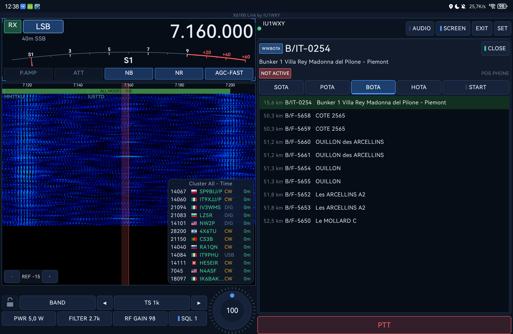

Lists from the phone (firmware 0.127): LISTS on the app's Field page opens a
small window. SEND downloads the SOTA, POTA, WWBOTA and HOTA lists on the
phone, over the phone's own connection, and sends the radio only the
references within 50, 100 or 300 km (100 by default) of the radio's Field Ops
position (GPS, phone or QTH locator, shown as a 4-character locator). The
first time the phone downloads about 38 MB; it keeps the lists and later
downloads only the ones that changed. The radio gets a few hundred kB at most
instead of 38 MB over its WiFi. The radio's list changes only once the whole
upload has arrived: if it stops halfway, the old list stays. A list the phone
could not download stays on the radio as it was.
Away from the area the radio knows no references: send the lists again from
the new place, or use RADIO DOWNLOAD in the same window (the same as Update
list on the radio) for the whole world. Update list on the radio works as
before and brings back the whole lists.
With an Ethernet adapter and WiFi on the same network, connect the app to the
cable's address: in that setup big uploads over the radio's WiFi stalled in
my tests.

Bands screen: for each band the cluster spots of the last 30 minutes, the
Reverse Beacon Network skimmer spots of the last 15 and the skimmers that
heard you in the last 10 (with the best SNR); the activity as a bar and
HIGH / GOOD / FAIR / POOR, the best band marked.

- Test beacon sends `TEST DE <call>` in CW (the radio must be in CW), so you
  can see who hears you.
- Use band (or a press) tunes a typical activation frequency of the band.
- RBN is connected while the screen is open (the first minute fills the
  counts); it needs WiFi and the callsign.
- The skimmer data comes from the Reverse Beacon Network
  (reversebeacon.net), thanks to its skimmer operators.

LOG tile. The page title is "<program> LOGBOOK <reference>" with a red TEST:
the page and its QRZ upload are experimental. It lists the QSOs of the
activation log (N, TIME, CALL, BAND, MODE, RST S / R). Buttons: Log QSO,
Upload QRZ, Back.

- Upload QRZ (experimental) sends the whole activation log to your QRZ.com
  logbook. QSOs already there are counted, not sent again: "QRZ: 5 sent, 2
  already there".
- It needs your QRZ Logbook API key, pasted on the Field Ops page of the web
  configurator.
- Uploading to QRZ needs a QRZ.com Logbook API key, which QRZ.com only gives
  with a paid QRZ.com subscription (XML level or higher).
- Other messages: "Uploading the log to QRZ...", "No log to upload", "No QRZ key:
  add it on the web page, Field Ops", or "QRZ: " with the reason QRZ gave and how many went before it.

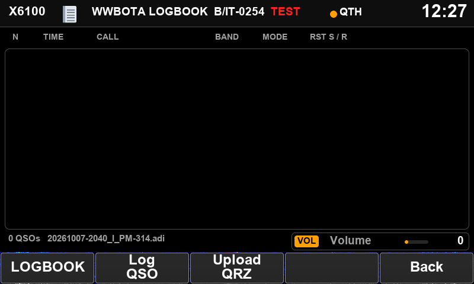

Start and Spot also post the spot on the DX cluster (`POTA IT-0123 SSB`,
`SOTA I/LO-123 CW`); the QSY spots don't.

WWBOTA (World Wide Bunkers On The Air) and HOTA (History On The Air) work
like POTA, with their own tile.

- Update list downloads the bunkers (wwbota.org) and the HOTA references
  (cqhota.app) with the parks and summits. Lists that did not change since
  the last update are not downloaded again.
- The activation screen shows what a valid activation needs: `QSOs / 25` in
  WWBOTA (`/ 10` for the S5 and Z3 bunkers), `CALLS / 5` in HOTA (different
  calls, the same UTC day, within 500 m), `QSOs / 10` in POTA, `QSOs / 4` in
  SOTA.
- The log has `MY_SIG WWBOTA` or `MY_SIG HOTA` and `MY_SIG_INFO` with the
  reference.
- Spots: the same rules as POTA (Start, Spot, after a QSY, QRT at End).
  WWBOTA spots go to wwbota.org, no account needed. HOTA spots go to
  cqhota.app with your own key: on cqhota.app, My account > Integration API
  key, then paste it in the web configurator's Field Ops page. Without the
  key HOTA spots go to the DX cluster only, and the message says so.

### Bands

The band overview of Field Ops as an app of its own, in the look of the other
apps: APP (page 3) > Bands, or a long-press action.


- Each band shows its activity bar and word, the cluster / RBN spot counts
  and who heard you (skimmers, best SNR); the best band is framed.
- MFK to choose, a press (or Use band) tunes a typical frequency of the band
  (CW or phone, as the radio's mode).
- Test beacon sends `TEST DE <call>` in CW. ESC closes.
- The numbers are the same as in Field Ops.

### Channels

A list of named frequencies: APP (page 2) > Channels, the long-press action
APP Channels, or the V/M key of the hand mic.

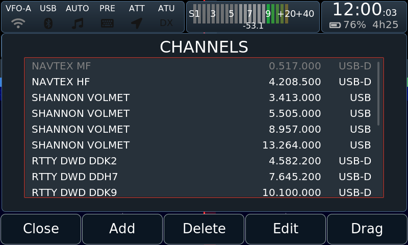

- The CHANNELS window has a row for each channel: the name on the left, the
  frequency and the mode on the right. A channel with no name shows as
  "CHANNEL n".
- The MFK moves along the list; a press tunes the channel (frequency, mode,
  AGC, PRE, ATT) and closes the window.
- Close closes it. Add stores the current VFO (frequency, mode, AGC, PRE, ATT)
  as a new channel at the end of the list. Delete removes the channel under
  the cursor. Edit renames it (the keyboard opens, "Channel name").
- Drag picks the channel up and the button becomes Drop: the MFK carries the
  channel up and down, Drop saves the new order.
- Hand mic: V/M opens the window (not over WeFax, NavTex, SSTV, JS8, PSK,
  Olivia or JTTY); UP and DOWN tune the channel before or after the last one
  tuned and show its name for a moment, without opening the window.
- Up to 100 channels. They are the same as on the web configurator's Memories
  page and in the MEMORIES tab of X6100 Link; a change made there shows on the
  radio within a few seconds, unless the window is open.
- The first list has NAVTEX MF and HF, SHANNON VOLMET, the DWD RTTY stations
  and the DWD and GYA WeFax stations.

## Bluetooth

### Bluetooth headphones

Radio RX audio to A2DP headphones. Everything is in Settings > Bluetooth:
pairing and connection in DEVICES, the audio switches in HEADPHONES.

1. Switch Bluetooth on, put the headphones in pairing mode and press Scan
   (16 s).
2. An MFK press on a device marked *new* pairs, trusts and connects it; it
   also opens the pairing window (the Pairing switch counts down). What it is
   doing, or why it failed, shows on the Activity row. On a paired device
   the menu offers Connect / Disconnect, Connect at startup and Forget.
3. HEADPHONES, with the headphones connected:

| Option | What it does |
|---|---|
| RX to headphones | a PulseAudio loopback from the radio RX audio (`alsa_input.platform-sound.stereo-fallback`) to the headphones |
| Volume | the headphones sink volume |
| Mute speaker | AF volume 0 while the headphones are connected, back to the previous value when they disconnect. The AF volume does not change the audio sent to the headphones. |

- Only A2DP is used: HFP/HSP (SCO) gives no audio on this radio and drops the
  WiFi, so PulseAudio has no headset backend
  (`rootfs/etc/pulse/system.pa.d/btaudio.pa`). The same file stops PulseAudio
  from looping a phone or tablet that connects for CAT (it also appears as an
  A2DP source) into the radio TX audio.
- The headphones get mono audio, like the radio's, with about 0.4 s of delay;
  it can grow to 0.7 s when the link is busy.
- WiFi runs at 20 MHz only, so it leaves more of the band to the headphones.
- Bluetooth keyboards (for [CW from the keyboard](#cw-from-the-keyboard)) are paired the
  same way: Scan also finds keyboards, marked *keyboard* in the list (one
  that never sends its name shows as *Keyboard* and its address). After the
  MFK press, press the keyboard's pairing key when asked; if it asks for a
  code, the code to type (then Enter) shows on the Activity row. A keyboard
  that takes a new address at each pairing is found again by its name.
- Pairings are kept in a backup on `/mnt` and restored at boot
  (`S39btpairings`), so a new image does not forget them.

> **WiFi and Bluetooth share one chip.** With both on, the headphone audio can
> skip, WiFi slows down and the chip sometimes resets. The built-in WiFi is
> weak anyway: for X6100 Link and the web configurator a cable works better, a
> USB Ethernet adapter ([Ethernet](#ethernet)) or a phone on
> [USB tethering](#usb-tethering).

### Bluetooth CAT

`btcat` (`btcat/btcat.c`) opens the real CAT UART (`/dev/ttyS2`) and
bind-mounts a pty over it, so the GUI talks to btcat. USB CAT and up to 3
Bluetooth clients share the CAT port: one request at a time, replies go back
to whoever asked, transceive frames (dst `0x00`) go to everyone.

Where: Settings > Bluetooth (ADAPTER and BLUETOOTH CAT cards).

| Option | What it does |
|---|---|
| Bluetooth | adapter power |
| Pairing (3 min) | visible and pairable for 3 minutes, then off by itself; the label counts down |
| Clients | Bluetooth CAT clients connected now, or "bridge not running" |

CAT accepts paired devices only (RFCOMM security level medium): a device in
range that has not paired cannot open the port. Outside the pairing window
the radio is hidden, not pairable and its pairing agent refuses every
request; paired devices still connect. To pair a phone or PC once: switch Pairing on, then pair from
the phone or PC within 3 minutes (Just Works, no PIN). When the window closes
the new devices are marked trusted and the pairings are saved on `/mnt`.
Pairing a keyboard or headphones from the device list opens the window too.
On Linux: `rfcomm connect /dev/rfcomm0
<BT-MAC> 1`, then use `/dev/rfcomm0`. On Windows and Android the paired
device exposes an outgoing COM/SPP port. Log files: `/tmp/btcat.log`,
`/tmp/btcat-setup.log`. Connection details: [reference](#bluetooth-cat-connection).

## Themes

Every colour of the GUI comes from a role (background, button, selected row,
header text, OK, TX, ...). A theme gives each role a colour, plus corners,
borders, gradients, the font and the waterfall palette.

Where: Settings > Display > INTERFACE > Theme (also on the web
configurator's Display page). The new theme applies at once, with no
restart.

| Theme | Look |
|---|---|
| IU1WXY | default: dark blue-grey, cyan headers |
| Classic | black, grey keys, IC-7300 style |
| Outdoor | for the sun: light, black text, grey waterfall, S-meter in one grey gradient |
| Outdoor-Negative | Outdoor with the lightness inverted: dark, white text, the hues kept |
| VISION | for weak eyes: big type, white digits on dark grey, orange for what is on, aqua frames; the S-meter on a row of its own, always bars |
| Black Metal | designed by 2E0JFS: two rows of state on top (ATT PRE, NR NB DNF, AGC, SPL ATU, RIT XIT; mode, filter, BW, IF, STEP, scope span), S/SWR/ALC scales beside a big frequency with the 10 Hz digits smaller, the other VFO and an A/B badge, the span edges in the spectrum, one-line buttons; brushed grey panels, cyan for the tuned digit and the encoder's control, Roboto |
| Total Black | designed by 2E0JFS: Black Metal on pure black, the buttons marked by a thin grey line on top |
| RS | RS-BA1 look: glossy buttons with LEDs, black LCD, Arial; drawn with images |
| your files | `/mnt/themes/<name>.json`, or a folder `/mnt/themes/<name>/theme.json` with PNG images |

- A theme file sets only what it changes; the rest comes from its `base`
  theme.
- A folder theme can draw the background, the buttons (normal, active,
  disabled, page), the top bar, the frequency strip, the app windows and the
  encoder LED with PNG images, 9-sliced to the size of each surface.
- RS is such a folder: it is installed with the image and copied to
  `/mnt/themes/RS` at the first start (`themes/RS`, generated by
  `themes/make_rs.py`).
- Legacy is kept in the code but not offered in the menu.
- File format, images and the list of roles:
  [docs/THEMES.md](THEMES.md).

Encoder LED. The bottom buttons show which encoder their control is on. The
control the encoder adjusts now has a red LED, which follows button presses
and encoder changes. A theme can draw the LED with an image.

Fonts. Sony Sketch, Roboto and DejaVu (default) are in Settings > Display >
INTERFACE > Font. Arial is set by a theme's `font` (the RS theme uses it);
its LVGL sizes are generated with `tools/font_gen.py`.

## Web configurator

A small web server (vendored in [webserver/](../webserver/), Python/bottle) runs
on the radio on port 80. Open `http://<radio IP>/` from any browser on the
same network. The radio picks up changes within a few seconds.

The menu has General and four groups:

| Group | Page | Does |
|---|---|---|
| | General | index of the pages |
| Frequencies | Bands | band edges and default modes |
| | Digital modes | add, edit and delete the FT8/FT4, JS8, WSPR and FT2 frequencies |
| | Memories | MEM 1-9 slots and the named channel list ([Channels](#channels)) |
| Operating | Remote | tune the radio from the browser: frequency, mode, band, filter, RF gain, PRE/ATT/AGC/NB/NR, live spectrum and waterfall (click or drag to tune), RX audio (HTTPS page, one listener). Receive only (no PTT); transmitting remotely is done by the [X6100 Link app](#x6100-link-app) |
| | Cluster | DX cluster servers, filters and alerts (writes `/mnt/cluster.conf`) |
| | Field Ops | QRZ Logbook API key and upload, HOTA key, update the reference lists, download the activation logs |
| | CW messages | the MSG > CW messages: add, edit, delete (1-64 characters) |
| | Macros | the PSK31, Olivia and JTTY macros (add, edit, move up, delete) and the JS8 INFO and STATUS answers (see below) |
| | Logs | every QSO on the radio, day by day: edit, delete, export as ADIF or CSV |
| Files | Files | browse and download `/mnt` |
| | Gallery | screen recordings, voice recordings, screenshots, SSTV and WeFax pictures (see below) |
| | Backup | download settings, memories, cluster, wfview, QSO log, voice messages (optionally CW trainer and WiFi) as one file, and restore the parts you choose |
| System | Display | every display option of the radio (see below) |
| | Time | local and server time; Sync sets the radio clock from the browser's, in the radio's timezone; NTP sync; timezone |
| | Ethernet | the USB Ethernet adapter: state, DHCP or static address (see [Ethernet](#ethernet)) |
| | wfview | enable the wfview server, set user and password |

Gallery: a folder per kind (screen recordings, voice recordings, screenshots,
SSTV and WeFax received and to send) with count and size.

Macros page (Operating > Macros): the macro buttons of the PSK31 and Olivia
windows (up to 12 each, name up to 23 characters, text up to 199, tokens
`<MYCALL>`, `<CALL>`, `<RST>`, `<RSTR>`), the JTTY F1-F8 keys (text up to 80,
tokens `%M`, `%H`, `%E`) and the JS8 answers to INFO? and STATUS? (up to 64
characters each). Plain ASCII only. It writes `/mnt/psk_macros.txt`,
`/mnt/olivia_macros.txt`, `/mnt/jtty_macros.txt` and the INFO and STATUS lines
of `/mnt/js8_texts.txt`. The radio reads them when the window opens, so close
and reopen the window to see the changes. RTTY sends only from X6100 Link,
which has its own macros.

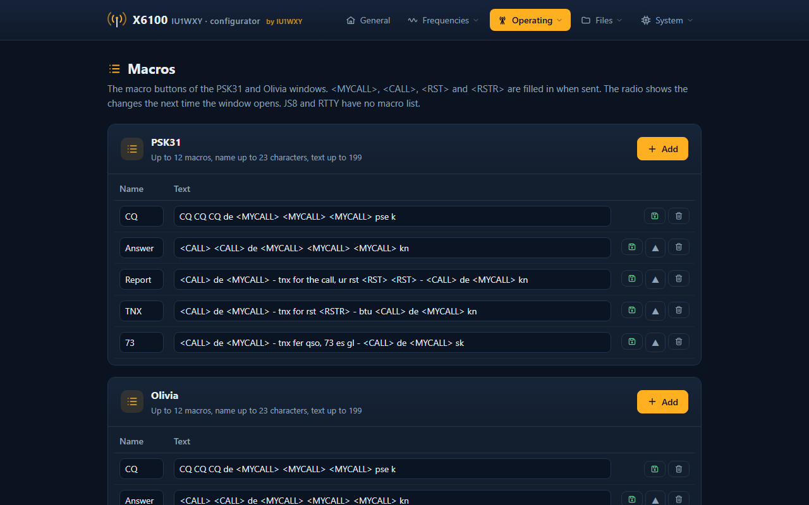

- Multi-select (tap, checkbox, shift for a range, all/none); delete the
  selection with one confirmation or download it as a ZIP.
- Upload several pictures into the SSTV and WeFax TX folders (other formats
  are converted to PNG in the browser).
- Convert AVI to MP4 in the browser (HTTPS page only) or on the radio.

Display page (System > Display): the same options as Settings > Display,
applied on the radio as you change them.

| Card | Options |
|---|---|
| Theme | Theme (the radio's screen restarts with the new one) |
| S-meter | S-meter type (Bars, Needle), Colours (Theme, Scale, Level), Needle lamp; with a preview |
| Waterfall | Mode (Centered, Fixed), Speed (1-5), Auto level, Auto level offset (-15 to +15 dB), Center line, Zoom, Smooth scroll |
| On the waterfall | Band plan, Cluster spots, Cluster column |
| Backlight | Brightness, Brightness when idle, Idle after (5-120 s), Button lights (Always off, Always on, Temporarily on) |
| Text and info | Knob info, Magnify frequency, Magnify info, Magnify ALC |

HTTPS. The server also listens on port 443, with a self-signed certificate
made on first start (valid 10 years, stored in `/mnt/https/`). The browser
shows a certificate warning once; accept it. In-browser MP4 conversion in the
Gallery only works on the HTTPS page (WebCodecs needs a secure context);
"Convert on radio" works on both.

Server options: `--host`, `--port`, `--https-port` (0 = off), `--cert-dir`,
`--db`, `--cluster-conf`, `--wfview-conf`, `--channels-file`,
`--filebrowser-path`, `--debug`; see
[webserver/README.md](../webserver/README.md).

| Cluster | Digital modes |
|---|---|
|  | 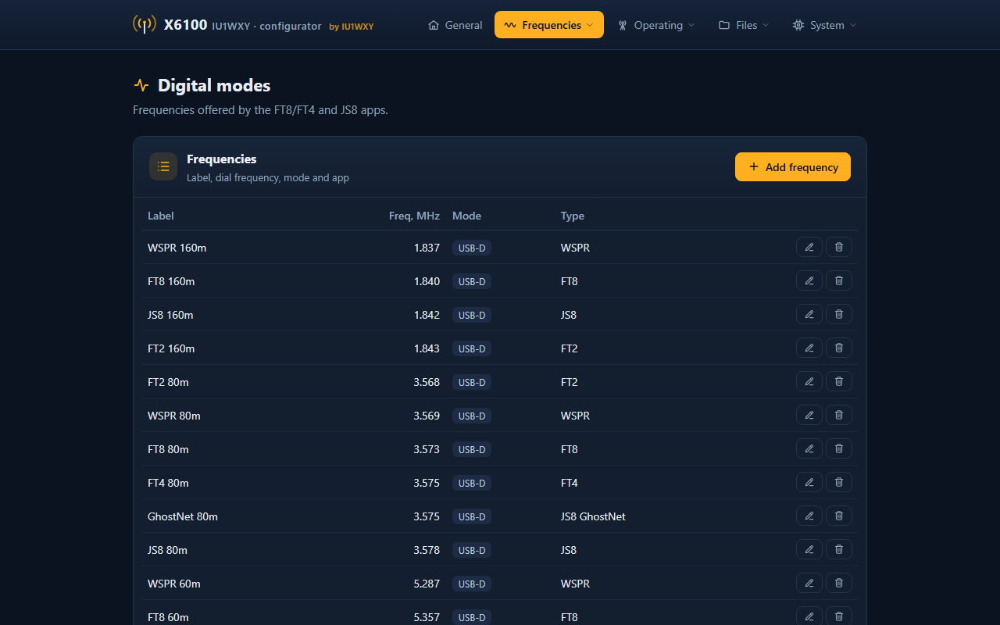 |

The same server carries the remote control used by the X6100 Link app.

## X6100 Link app

X6100 Link is a separate Android app (not part of this repository) for this
firmware: the radio decodes and transmits, the phone or tablet shows and
commands it over WiFi. An app older than the firmware is refused, and the app
asks for a newer firmware when the radio's is older.

Connect:

1. Turn on the phone's hotspot.
2. Connect the radio to it (Settings > Wireless).
3. Open the app. It tries the last radio, otherwise scans the phone's
   networks for `/api/info`. Tap the radio found, or type its IP.

What it has:

| Part | What it does |
|---|---|
| Radio | frequency, band, mode, tune steps, VFO knob, P.AMP/ATT/NB/NR/AGC, S-meter, spectrum and waterfall (tap or drag to tune), RX audio |
| Log (the default) | call, RST and LOG into the radio's log of the day (`YYYYMMDD.adi` with the Field Ops logs, downloadable from the web configurator). With a QRZ.com login the call's record shows under it (name, QTH, grid, country and flag, zones, distance, photo) and goes into the log. SOTA/POTA opens Field Ops. |
| Apps | all eight, with TX in all but NavTex: FT8/FT4 (CQ, reply, auto, hold, TX frequency), JS8, WSPR, SSTV (pictures from the phone's gallery or a camera photo, call and text), WeFax (received faxes full screen, zoom, save, share; send a picture), NavTex (receive only), RTTY and CW (text to send, macros with `{CALL}`, the characters already on the air in cyan) |
| Themes | Classic, Pro, Outdoor and Outdoor-Negative |
| Languages | English or Italian (the app's settings) |

- VFO lock: while an app is open on the radio, frequency, band, mode and
  tap-to-tune are locked (padlock to unlock). BASE goes back to the app's
  frequency and mode (*OFF BASE* blinks when the VFO is elsewhere). In
  FT8/FT4 a tap on the waterfall sets the TX audio frequency.
- Portrait (radio on top, app below) and landscape (side by side); rotation
  keeps the connection.
- FT8 and JS8 "For you": up to 3 recent messages to you stay pinned under the
  list for 2 minutes (in FT8 a caller also leaves after your 73 or RR73). A
  tap replies.

Phone screen. The radio panel has one RX/TX lamp, a block with the mode and the
band, and the reading inside the dial; P.AMP, ATT, NB, NR and AGC are buttons,
PWR is on the filter row. SET > Display > Filter colour colours the filter on
the app's spectrum and waterfall: Theme, Blue, Sky blue, Green, Yellow,
Orange, Red, Purple, White (the radio has its own, see
[Waterfall](#waterfall)). SET > DX CLUSTER > Column transparency sets how much
the waterfall shows through the cluster column, 25% by default.

SET has its sections on the left in three groups: Look (Theme, Display,
Language), Radio (DX CLUSTER, PADDLE, PTT, Update) and Account and privacy
(QRZ.COM, Phone position). It opens on the section used last.

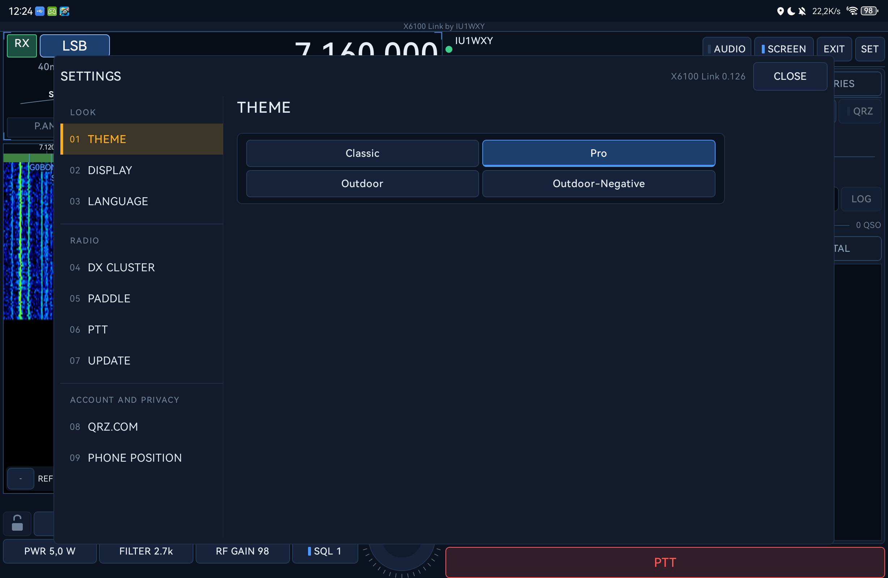

Logging a DX cluster spot. Tap a spot in the app's cluster column, or tune a
spot with the MFK on the radio: the app tunes it and opens the logger with
the call filled in, the RST at 59 (599 in CW) and, with a QRZ.com login, the
QRZ data. Nothing is logged until you tap LOG.

Upload to QRZ.com. QRZ in the LOG tab sends today's QSOs that are not on
QRZ.com yet. The key goes in SET > QRZ.COM, "Logbook API key": it is on QRZ.com
under My Logbook, Settings, and it is not your password. Without the key the
button reads "QRZ upload off: tap here to add the logbook API key". Messages:
"QRZ: 3 sent, 1 already there", "QRZ: nothing new to send", or "QRZ: " with the
reason, after those already sent.

Uploading to QRZ needs a QRZ.com Logbook API key, which QRZ.com only gives
with a paid QRZ.com subscription (XML level or higher).

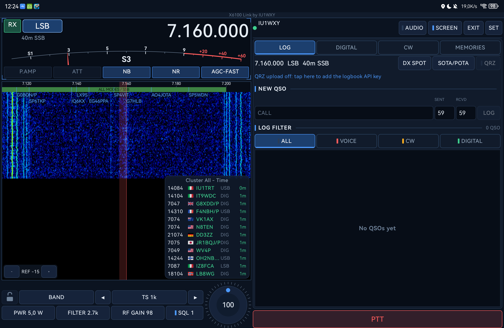

Cluster alerts on the phone: when a spot matches one of your alerts (SET > DX CLUSTER), the phone shows a notification with call, frequency, mode, spotter and comment, also with the app in the background; a tap opens the app. The same call on the same band is notified once every 10 minutes. Turn it off with Phone notification, next to the alerts. Inside the app an alert spot shows as a banner at the top for 15 s; a tap tunes it. In SET > DX CLUSTER an alert removed by mistake comes back with UNDO for 5 s.

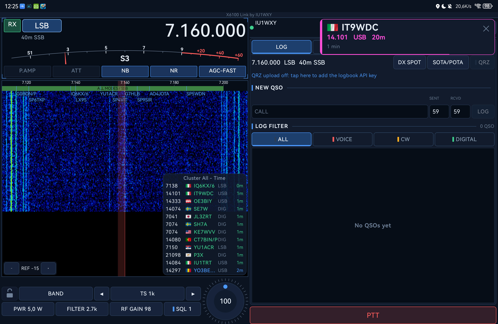

DX spot from the phone (firmware v0.127 or newer): DX SPOT in the logger opens a small window with the VFO in kHz, the call (CW LOG call, last confirmed CW call or FT8 caller tapped) and a comment starting with the mode. Send posts it through the radio's cluster connection; an error from the radio shows in the window.

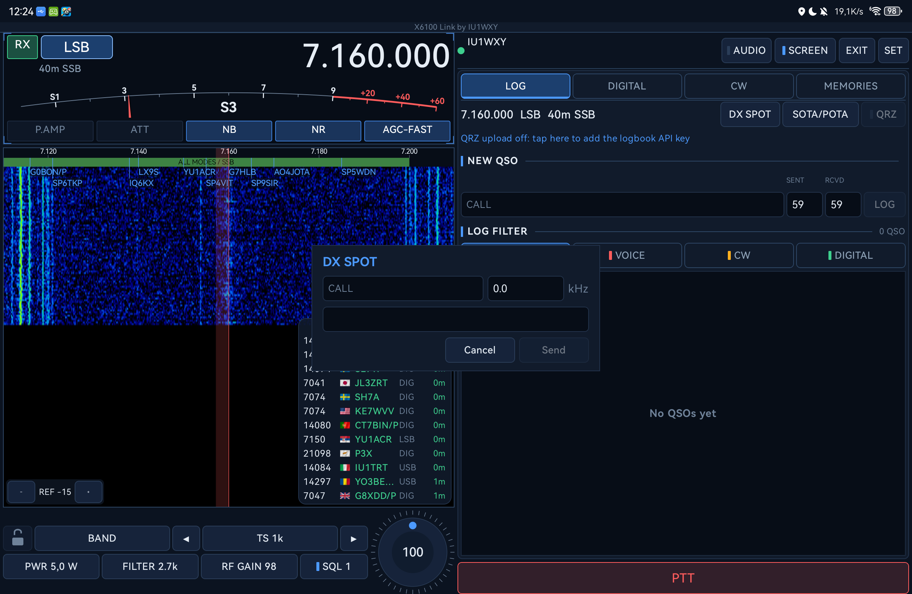

Transmitting from the phone: the app's TX commands (CQ, reply, send...) work
as soon as the app is open on the radio. Stop always works. When an app
opened from the phone changed the mode (CW, or USB for SSTV/WeFax/NavTex),
the mode comes back when the app closes.

Voice from the phone (firmware v0.127 or newer). A red PTT sits under the log:
hold it and talk into the phone. It works only in LSB, USB, AM and FM; the
first time Android asks for the microphone, and leaving the app lets PTT go.

- SET > PTT > Mic gain: the phone's microphone level, -30 to +20 dB. Watch
  the ALC while you talk: it should move, not sit at the top.
- TX stops after 0.5 s without audio from the phone, and after 3 minutes.
- On the radio: "Phone PTT: voice only in LSB, USB, AM and FM", "Phone PTT:
  the radio is already transmitting", "Another device is transmitting",
  "Phone PTT: TX stopped, no audio from the phone", "Phone PTT: TX stopped
  after 3 minutes", "Phone PTT: TX stopped by the radio".
- In the app: "TX stopped after 3 minutes: release PTT", "PTT: microphone or
  network not available", "PTT needs the microphone: allow it in the app
  permissions".

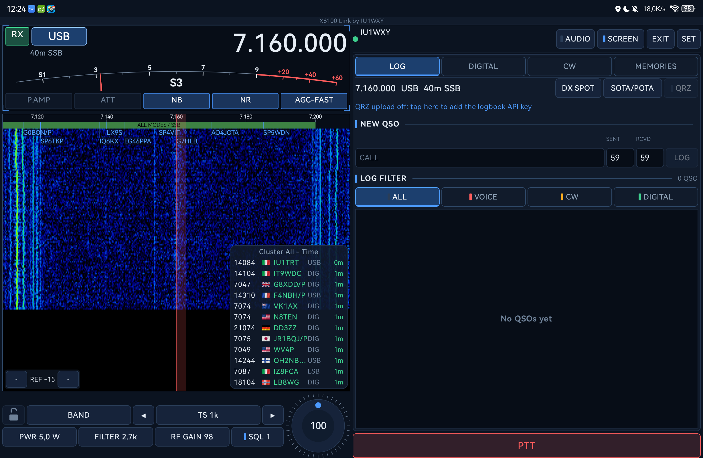

Memories (MEMORIES, next to LOG/DIGITAL/CW). The radio's MEM slots M1-M9 and
its named channels, the same ones as on the radio and on the web
configurator's Memories page. Tap one to tune it (frequency, then mode).
Hold it down for its actions: SAVE VFO stores the radio's frequency, mode,
AGC, P.AMP and ATT in that slot, CLEAR empties it; a channel can be renamed,
moved up or down, or deleted (asked once more). Type a name and SAVE VFO to
add the VFO as a new channel. Needs firmware v0.125 or newer.

USB paddle on the CW tab. The paddle plugs into the phone or tablet through
an OTG adapter and can be any of three kinds: one that shows up as a USB mouse
(dit = left button, dah = right), a keyboard adapter such as the Vail adapter
(Left Ctrl = dit, Right Ctrl = dah; [ and ] work too), or a USB MIDI device
(highly experimental; note on/off; notes 1 and 2 by default, as the Vail adapter in MIDI mode).
Other buttons, keys or notes are set in SET > PADDLE with LEARN: press the
dit, then the dah, and the app keeps what arrived for that kind of input;
RESET goes back to the defaults. Turn on PADDLE: the app takes the mouse
pointer, so the buttons no longer click the screen, and the mapped keys no
longer type in any field. SET > PADDLE also has the keyer: iambic B (default),
iambic A (letting go of a squeeze stops after the element being sent),
straight key (either contact keys the tone, dit or dah decided by its length)
or bug (dits automatic, dahs by hand); SWAP, also on the CW tab, exchanges dit
and dah. Speed is the radio's TX WPM or a value of your own. The sidetone on
the phone can be turned off; its pitch is the CW filter centre (AUTO) or a
fixed value, its volume the app's audio volume (AUDIO) or a fixed level. A gap
of 3 dits ends a character, 7 dits a word (keyed by hand: 2 and 6). What you
key goes to the radio as text and the radio keys it at its own speed, as with
the text to send, so it goes out only in CW: on firmware v0.127 each letter
as soon as it is decoded, before that a word at a time. The line next to
PADDLE shows the word being formed; a pattern that is no character is dropped
and shows a red ?. PADDLE turns off when the app leaves the screen, the CW tab
or SET opens. A paddle on a USB serial adapter (DTR/DSR/CTS) is not
supported.

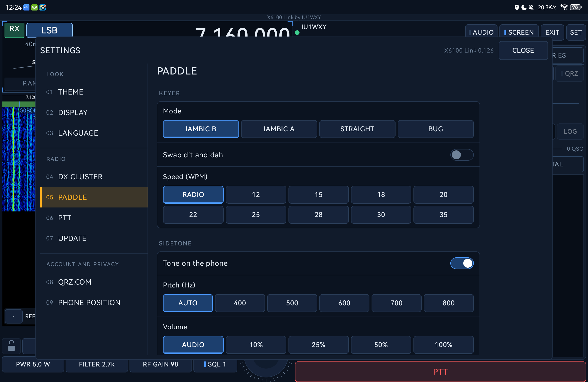

<table>
  <tr>
    <td align="center"><br><sub><b>FT8</b>, portrait</sub></td>
    <td align="center"><br><sub><b>CW</b>: macros, text on the air</sub></td>
    <td align="center"><br><sub><b>WeFax</b>: received faxes, picture TX</sub></td>
  </tr>
  <tr>
    <td colspan="3" align="center"><br><sub><b>Landscape</b>: radio on the left, app on the right.
    App screenshots taken on an emulator against a mock radio (fake data).</sub></td>
  </tr>
</table>

### Log export, eQSL, LoTW
- ADIF (LOG tab): all the radio's logs in one file, to any app from the share sheet (mail, Drive, Files).
- EQSL (LOG tab): today's QSOs not yet on eQSL.cc. Login in SET > EQSL / LOTW; it stays on the phone and goes only to eQSL.cc.
- LoTW: the phone can't sign for LoTW. Export with ADIF, then sign and upload with TQSL on a computer.
### Alerts and quick controls
- SET > Alerts: battery 10% and 5% (once each, again after charging), SWR protection stop, recording saved. They need a radio with firmware 0.127.
- Quick controls: switch on "Controls in the notification". The notification shows frequency, mode, band and volume, and up to 4 keys: tap a slot under the switch to pick its key, left to right, or "—" to leave it empty. BAND-/BAND+ change band as the radio's keys, VOL-/VOL+ move the volume by 2, MODE steps LSB, USB, CW, AM, NFM, AGC steps its modes, ATT, P.AMP, NB and NR switch on and off. Defaults: BAND-, BAND+, VOL-, VOL+.
- Keeping the alerts on keeps the "Connected to the radio" notification while the app is connected.

## wfview server

The radio can act as an Icom IC-705 on the network, so
[wfview](https://wfview.org) on a PC controls it with CI-V, RX audio and the
waterfall.

- Off by default. Enable it in Settings > General > WFVIEW SERVER or on the
  web configurator's wfview page.
- Default login `x6100` / `x6100`: change it in the same places (stored in
  `/mnt/wfview.conf`).
- Ports: UDP 50001 (control), 50002 (CI-V), 50003 (audio).
- In wfview add a network radio (IC-705 profile): radio IP, control port
  50001, the user and password above, audio codec LPCM 1ch 16bit.
- The WFVIEW SERVER card shows the connected client.

## Ethernet

A USB Ethernet adapter in the radio's USB port gives it a wired connection
next to WiFi. Adapters with the common chips work (ASIX, Realtek
RTL8152/8153, CDC Ethernet/NCM). It can be plugged in at any time.

Where: Settings > Wireless > ETHERNET, or the Ethernet page of the web
configurator (System > Ethernet). Both show the same settings. The ETHERNET
card is there only while an adapter is plugged in: it appears and goes away
with the adapter, also with the page open. Without one the web page says
"No Ethernet adapter connected".

- Status: connected, no cable, connecting or not connected, and the
  adapter's name (eth0).
- Address in use / Gateway in use: what the adapter has now.
- Mode: DHCP (the default, the network gives the address) or Static.
- IP address, Netmask, Gateway, DNS: used in Static mode. The netmask can be
  written as 255.255.255.0 or /24. Gateway and DNS can stay empty.
- Apply: checks all the fields and saves them. Nothing changes until Apply.

On the radio, move to a field with the MFK and press it: the keyboard opens
for that field (the 1# key gives the digits). OK keeps the value only if it is
a valid address.

Apply refuses an address that is not a dotted quad, a netmask that is not
valid, the subnet's network or broadcast address, and a gateway outside the
subnet. The setting is kept across restarts and belongs to the port, not to
one adapter: another adapter gets the same address.

WiFi and Ethernet together: with a gateway set, internet traffic goes over
the cable and WiFi stays connected for its own network. Leave the gateway
empty and the cable reaches only its subnet, while internet stays on WiFi.
Changing Ethernet never touches the WiFi settings.

### USB tethering

> **Experimental.**

An Android phone or tablet with USB tethering can sit on a cable in the
radio's USB-A port. Turn on USB tethering on the phone: the phone gives the
radio an address, and the two reach each other over the cable. The radio's
internet stays on WiFi or Ethernet.

- There is no screen for it on the radio, and it does not show on the
  ETHERNET card.
- iPhone is not supported.
- Not tried with many phones yet.

## Troubleshooting and FAQ

#### FT8, JS8 or WSPR decode nothing, or nobody answers

Check the clock: FT8 and JS8 need it within about 2 s, WSPR within about a
second. WiFi (NTP) or GPS sets it. FT8 and JS8 also have Time Sync.

#### The ALC reads about 1 in FT8 or JS8. Is it too high?

No. The TX level settles with the ALC working a little, with the power at the
setting. It comes down by itself over 3. See [Digital-mode TX level](#digital-mode-tx-level).

#### The ALC reads about 5 in CW. Is it too high?

No. In CW the base sets the power with its own ALC, and the bar is grey for
that reason. See [ALC in CW](#alc-in-cw).

#### I can't record a voice message with the built-in microphone

The radio's baseband records only from the hand mic: plug it in to record. See
[recording voice messages](#recording-voice-messages).

#### The power drops to 7 W when I open a digital app

That is the cap for the digital apps. Your setting comes back when you close
the app.

#### The DX Cluster shows no spots

Read the status line in the Cluster app. It needs WiFi and your callsign.
Check also the filters (Settings > Cluster): one mode and one band always
stay on, so a narrow choice can hide everything.

#### The MP4 conversion does not work in the Gallery

Open the web configurator on HTTPS (`https://<radio IP>/`) and accept the
certificate once, or use "Convert on radio".

#### A Bluetooth headset gives no audio for the microphone

Only A2DP (listening) is used: HFP/HSP gives no audio on this radio and drops
the WiFi.

#### The new font did not change anything

RS, Black Metal and Total Black have their own font and keep it: pick another theme
to see the font you chose.

#### The main screen's waterfall stands still

That is normal while JS8 is open.

#### The Diagnostics Send... says "not accepted now"

Ask IU1WXY first: the text is accepted only while reception is open. See
[Info tab](#info-tab).

#### Where are my logs?

FT8/FT4 in `/mnt/ft_log.adi`, JS8 in `/mnt/js8call_log.adi`, Field Ops in
`/mnt/field/logs/`, the app's logger in the day's log. The web configurator's
Logs page shows them all.

## Reference

### Bluetooth CAT connection

| | |
|---|---|
| Transport | Bluetooth SPP, RFCOMM channel 1 (or USB CAT) |
| SPP UUID | `00001101-0000-1000-8000-00805F9B34FB` |
| Pairing | required once, in the 3-minute pairing window; Just Works, no PIN; device name `X6100` (`BTCAT_ALIAS` in `/etc/default/btcat`) |
| Protocol | Icom CI-V, radio address `0xA4` |
| Frame | `FE FE A4 <ctrl> <cmd> [sub] [data] FD`; reply `FB` = OK, `FA` = NG |
| Baud (USB) | 19200 8N1 (ignored over BT) |
| Hamlib / flrig / wfview | rig model Xiegu X6100 |

### Supported CI-V commands

| Cmd | Sub | Function | Read | Write |
|---|---|---|:-:|:-:|
| `00` | - | Frequency (transceive, sent automatically on every change) | - | yes |
| `01` | - | Mode (transceive, sent automatically on every change; mode byte only, no filter) | - | - |
| `03` | - | Read frequency | yes | - |
| `04` | - | Read mode | yes | - |
| `05` | - | Set frequency (5 BCD bytes) | - | yes |
| `06` | - | Set mode (`00` LSB, `01` USB, `02` AM, `03` CW, `05` NFM, `07` CW-R) | - | yes |
| `07` | - / `00` / `01` / `A0` / `B0` | VFO: read current, VFO A, VFO B, A=B, swap A/B; `07 00` / `07 01` also sent automatically when the VFO changes (transceive) | yes | yes |
| `0F` | - | Split off/on | yes | yes |
| `10` | - | Tuning step (`00` 10 Hz, `01` 100 Hz, `02` 500 Hz, `03` 1 kHz, `04` 5 kHz) | yes | yes |
| `11` | - | Attenuator | yes | yes |
| `14` | `01` | AF volume (0-255) | yes | yes |
| `14` | `02` | RF gain (0-255) | yes | yes |
| `14` | `03` | Squelch (0-255) | yes | yes |
| `14` | `09` | CW pitch (0-255 = 300-900 Hz) | yes | yes |
| `14` | `0A` | TX power (0-255 = 0-10 W) | yes | yes |
| `14` | `15` | Monitor level | yes | - |
| `15` | `02` | S-meter (Icom scale, 120 = S9, for network clients) | yes | - |
| `15` | `11` | TX power meter | yes | - |
| `15` | `12` | SWR meter | yes | - |
| `15` | `13` | ALC meter | yes | - |
| `16` | `02` | Preamp | yes | yes |
| `16` | `22` | Noise blanker | yes | yes |
| `16` | `40` | Noise reduction | yes | yes |
| `16` | `44` / `46` | Compressor / VOX (always off, write ignored) | yes | - |
| `19` | `00` | Transceiver ID (returns `A4`) | yes | - |
| `1A` | `01` | Band (Icom codes `01` 160 m ... `09` 10 m, `10` 6 m, `15` none); write tunes the band's centre | yes | yes |
| `1A` | `03` | IF filter width (BCD index) | yes | - |
| `1A` | `06` | Data mode + filter; write only adds or drops the data mode (USB ↔ USB-D, LSB ↔ LSB-D) | yes | yes |
| `1C` | `00` | PTT (`00` RX, `01` TX) | yes | yes |
| `25` | `00` / `01` | Frequency of selected / unselected VFO | yes | yes |
| `26` | `00` / `01` | Mode + data mode of selected / unselected VFO | yes | yes |
| `27` | `10` / `11` | Scope on (always) / wave data output: waterfall data (about 30 frames/s) only to network clients (wfview); on serial and Bluetooth a stub | yes | yes |
| `27` | `14` / `15` | Scope centre mode (always centre) / span (follows the waterfall zoom, write sets the zoom) | yes | yes |
| `27` | `19` | Scope reference level (stub) | yes | - |

Anything else returns `FA` (NG).

Example, read frequency: `FE FE A4 E0 03 FD` →
`FE FE E0 A4 03 00 50 07 14 00 FD` (14.075.000 Hz).

### btcat-ctl

| Command | Effect |
|---|---|
| `btcat-ctl bt on\|off` | Bluetooth adapter power (= Settings > Bluetooth > Bluetooth) |
| `btcat-ctl discoverable on\|off` | Open / close the 3-minute pairing window: visible and pairable, the GUI's agent accepts pairing (= Pairing (3 min)) |
| `btcat-ctl status` | Print power and the time left in the pairing window |
| `btcat-ctl apply` | Re-apply power from `/mnt/btcat.conf`, close the pairing window |
| `/etc/init.d/S94btcat start\|stop\|restart` | Start/stop the bridge (set `BTCAT_ENABLE=no` in `/etc/default/btcat` to disable) |

### btaudio-ctl

Used by Settings > Bluetooth for the headphone audio. Scan, pair,
connect and remove are in the GUI itself, straight to BlueZ over D-Bus, with
its own pairing agent (log in `/tmp/bt_pair.log`).

| Command | Effect |
|---|---|
| `btaudio-ctl status` | Headphone audio state (tab separated) |
| `btaudio-ctl save` | Copy the pairings to `/mnt/backups/bluetooth.tgz` |
| `btaudio-ctl autoconnect MAC on\|off` | Connect at startup |
| `btaudio-ctl rx on\|off` | RX audio to the headphones (loopback) |
| `btaudio-ctl volume N` | Headphone volume, 0-100 % |
| `btaudio-ctl mute on\|off` | AF volume 0 while headphones are connected |
| `btaudio-ctl boot` / `monitor` | Started by `btcat-setup`: keeps the headphones on A2DP with the loopback up, connects the "Connect at startup" devices |

### Files on /mnt

The DATA partition, readable on a PC.

| File | What |
|---|---|
| `params.db`, `qso_log.db` | the radio's settings and QSO database |
| `cluster.conf` | DX cluster server in use, saved servers, filters and alerts |
| `cw_trainer.json` | CW trainer statistics and Calls best score |
| `wfview.conf` | wfview server on/off, user and password |
| `btcat.conf` | Bluetooth power, written by `btcat-ctl` |
| `btaudio.conf` | headphones settings (RX loopback, speaker mute, Connect at startup devices) |
| `ft_log.adi`, `js8call_log.adi` | FT8/FT4 and JS8 logs (ADIF) |
| `ft8_udp.conf` | FT8/FT4 WSJT-X UDP output: `enabled=`, `host=`, `port=`, `id=` |
| `app_freqs` | the last frequency and mode of each digital app |
| `psk_macros.txt`, `olivia_macros.txt`, `psk.conf` | PSK and Olivia macros, PSK squelch |
| `js8_inbox.txt`, `js8_held.txt`, `js8_texts.txt` | JS8 inbox, messages held for others, INFO/STATUS/alert words/groups |
| `incoming_log.adi` | put an ADIF log here to import it at the next start |
| `field/` | Field Ops state and activation logs (`field/logs/`) |
| `screenrec/` | screen recordings (AVI) |
| `themes/` | theme files and folders ([docs/THEMES.md](THEMES.md)); RS is copied here at the first start |
| `sstv/` | received SSTV pictures; `tx_pics/` pictures and `tx_text/` text templates to send |
| `wefax/` | received faxes; `tx_pics/` pictures to send |
| `https/` | the web configurator's HTTPS certificate |

`cluster.conf` example (the `host=`/`port=` lines are the server in use, each
`server=` line is a saved server, `name|host|port`):

```
host=dxfun.com
port=8000
server=DXFUN|dxfun.com|8000
server=NC7J|dxc.nc7j.com|7373
```

Defaults for the Bluetooth bridge are in `/etc/default/btcat`
(`BTCAT_ENABLE`, `BTCAT_BT`, `BTCAT_ALIAS`); the
runtime state in `/mnt/btcat.conf` overrides them.

## Build

GitHub Actions (`.github/workflows/main.yml`, *Build image*, about an hour)
builds the SD image with
[AetherX6100Buildroot](https://github.com/gdyuldin/AetherX6100Buildroot),
using this repository's GUI, the vendored `webserver/`, the boot logo
`boot/logo.png` (800x480) and the Bluetooth files in `rootfs/`.

- Run it manually (`workflow_dispatch`) on `main` for a test image, uploaded
  as the artifact `sdcard.<ref>.img.zip`.
- Push a tag: the same image is attached to a GitHub Release.

Locally: follow [docs/UPSTREAM_README.md](UPSTREAM_README.md): clone
AetherX6100Buildroot next to this repository, configure it with
`./br_config.sh` and `make` in its `build` directory, then run
`buildroot/build.sh` from this repository. The workflow's patch steps show
what to change in the buildroot tree to use this repository (GUI and
webserver from local sources, `boost` and `fftw-single` for JS8, RHVoice
dropped, boot logo).

After a full build, the GUI alone is rebuilt in WSL with `make
x6100-gui-rebuild` (then `make`) in `~/AetherX6100Buildroot/build`. Buildroot
copies the local GUI sources with `rsync -u`, so a newer file edited inside
`build/build/x6100-gui-*/` survives a rebuild: always edit this repository,
never the copy in the build tree.

Tests: `./run_tests.sh` builds and runs the host tests in `tests/` (FT8 QSO,
JS8 with the JSC word tables round trip, QTH, cluster, WSPR round trip down
to -27 dB, CW decoder, Field Ops, SSTV, WeFax, TX level, microphone level). Stand-alone checks, built
with the `gcc` line at the top of each file: `tests/test_rtty_tx.c` (RTTY TX
decoded back by the RTTY receiver, USB/LSB, normal/reverse, 45 and 75 Bd) and
`tools/wefax_loopback.c` (WeFax TX through the real decoder: APT start/stop
and the picture back by correlation).

UI harnesses: [tools/apps_ui_harness](../tools/apps_ui_harness) renders the
app dialogs (FT8, JS8, WSPR, SSTV with TX, WeFax, NavTex, Cluster, CW
Keyboard, Modes, Settings tabs, main screen) headless on a PC, with the real
button bar; `THEME=<name>` renders any theme. The screenshots in this README
come from it. [tools/js8_ui_harness](../tools/js8_ui_harness) runs the JS8 app
the same way under ASan/UBSan.

Design notes and UI mockups are in `docs/` (`docs/mockups/releases/`).
